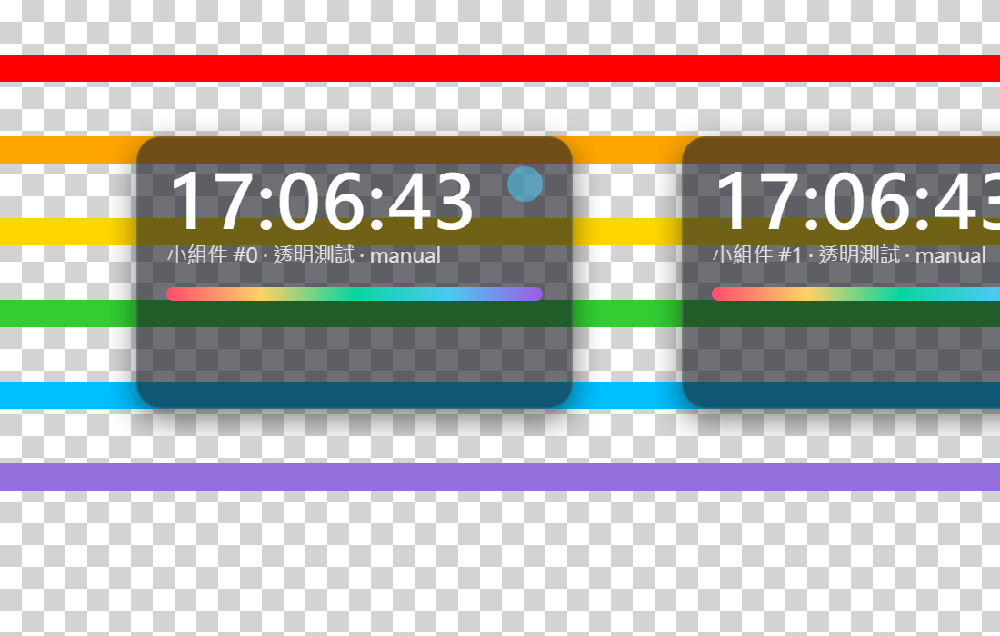
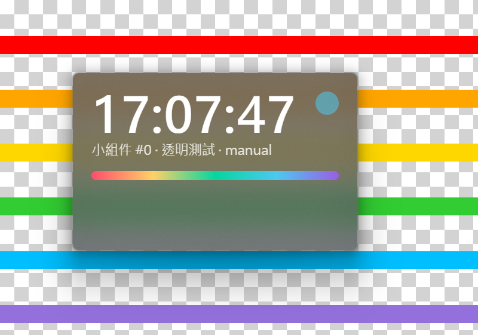
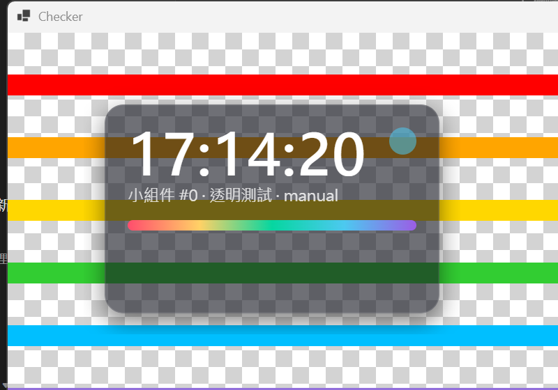
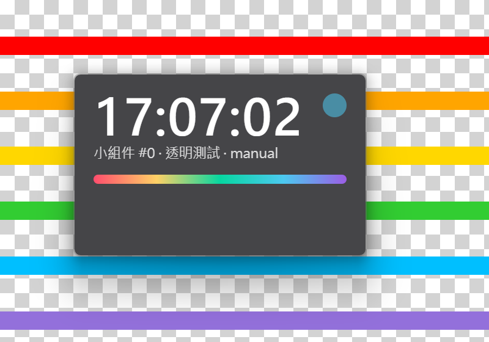

# M0 技術驗證報告

日期：2026-11-01
環境：Windows 11 Pro 10.0.26300（Insider）、2560×1600 @150%、WebView2 156.0.4314.58、.NET 9
驗證程式：[`spikes/M0Spike`](../spikes/M0Spike)

## 結論：C# + WebView2 方案可行，全部關鍵項目通過

| 項目 | 結果 | 做法 |
|---|---|---|
| 真透明 + 圓角 + 陰影 | ✅ | WebView2 背景設透明，視窗 `DwmExtendFrameIntoClientArea(-1)`，圓角和陰影用 CSS 畫 |
| 毛玻璃 | ✅ | `SetWindowCompositionAttribute`（Acrylic blur-behind），視窗沒被選中時也有效 |
| 系統 Mica / Acrylic | ❌ 不採用 | 視窗沒被選中時變成純色，桌面組件大部分時間都沒被選中 |
| 置頂 | ✅ | `WS_EX_TOPMOST`，Win+D 後仍在 |
| 桌面層（Win+D 不消失） | ✅ | 擁有者設為 `Progman` + `WS_EX_NOACTIVATE` + 放在 Progman 正上方 |
| 滑鼠穿透 | ✅ | `WS_EX_LAYERED \| WS_EX_TRANSPARENT` + `LWA_ALPHA 255`，透明效果不受影響 |
| 拖動 | ✅ | 三種方式都準確：手動追蹤游標、`HTCAPTION` 原生拖動、CSS `app-region: drag` |
| 多組件共用渲染進程 | ✅ | `--process-per-site` + 所有組件用 `*.widgets.local` 子網域 |
| 不用 GPU 時透明 | ✅ | `--disable-gpu` 下照常透明 |

截圖：

- 透明（背後是棋盤格測試圖）：
- 毛玻璃：
- 穿透模式：
- 系統 Acrylic 在視窗未被選中時變純灰（不採用）：

## 記憶體與 CPU 實測

「任務管理器」顯示的記憶體（私有工作集），整個進程樹合計：

| 情況 | 進程數 | 記憶體 |
|---|---|---|
| 1 個組件 | 7 | 96 MB |
| 5 個組件（共用渲染進程） | 7 | 112 MB |
| 5 個組件（不共用） | 11 | 約 170 MB（多 4 個渲染進程） |
| 5 個組件 + 關閉 GPU | 7 | 99 MB |
| 5 個組件 + 關閉 GPU + 低記憶體模式 | 7 | 92 MB |
| 10 個組件（共用） | 7 | 約 125 MB |

- 起步成本約 95 MB（主要是 WebView2 自身：瀏覽器主進程 ~35 MB、GPU ~22 MB），之後每多一個組件約 +4 MB。
- 比計劃預估的 120–180 MB 更好。
- CPU：5 個組件每秒刷新時鐘，合計 0.07%（關 GPU 為 0.03%），可以忽略。
- 關閉 GPU 可再省約 15 MB（提交記憶體省約 70 MB），適合做成「低資源模式」選項；代價是複雜動畫改由 CPU 繪製。

## 踩到的坑（M1 要處理）

1. **WinForms 表單會偷改視窗擁有者。** `Form` 在顯示時會把擁有者換成自己的隱藏視窗，導致「桌面層」失效。
   → M1 不用 `Form` 承載組件，改用原生視窗（`NativeWindow`）+ `CoreWebView2Controller` 直接承載。WinForms 只用來跑托盤圖標和消息循環。這樣也更輕。
2. **桌面層組件不能搶焦點**，否則一點擊就跳到其他應用前面。
   → 桌面層預設 `WS_EX_NOACTIVATE`；需要打字的組件（便利貼、待辦）在輸入框獲得焦點時臨時允許啟用，失焦後回到桌面層。
3. **陰影留白區會攔截點擊。** 透明模式下卡片四周留了約 20px 給陰影，這部分雖然看不見，但點擊不會穿透。
   → M1 低優先：游標在留白區時自動切換穿透，或縮小留白。
4. **毛玻璃模式的圓角固定**為系統的 8px，不能自訂；透明模式的圓角可隨意設定。
5. 毛玻璃用的是未公開 API（Windows 10 起一直可用，很多工具在用）。如果將來失效，自動退回透明模式。

## 對計劃的調整

- 視窗承載：`Form` → 原生視窗 + `CoreWebView2Controller`。
- 外觀風格：提供「透明」和「毛玻璃」兩種，不使用系統 Mica / Acrylic。
- 新增「低資源模式」設定（關閉 GPU 加速 + 低記憶體目標）。
- 記憶體預估更新為：1 個組件約 95 MB，之後每個 +4 MB。

## 驗證程式參數（供日後重測）

```
M0Spike.exe [--count=N] [--z=normal|top|desktop] [--noact] [--ct=layered]
            [--backdrop=none|blur|accent|acrylic|mica] [--drag=manual|native|appregion]
            [--pps=1|0] [--memlow] [--extra=--disable-gpu] [--testbg] [--bg=x,y,w,h] [--x= --y=]
```
