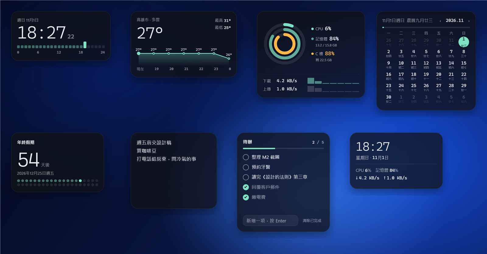
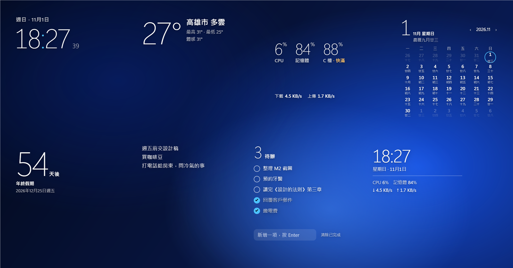
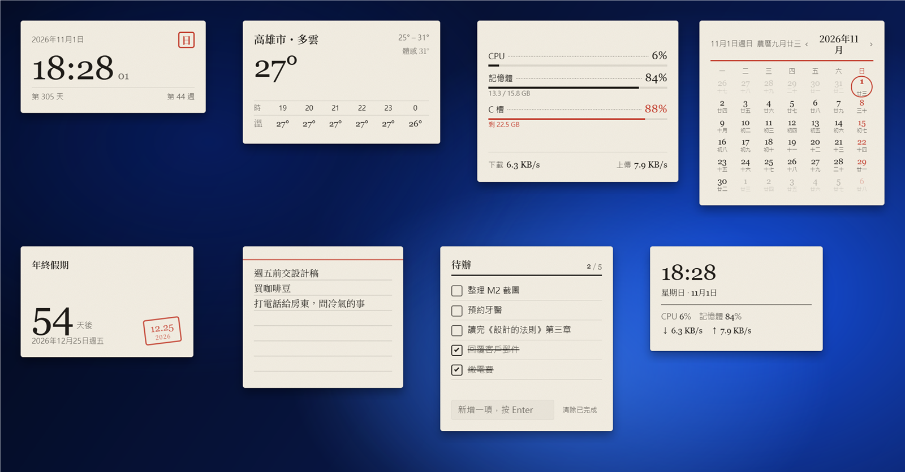
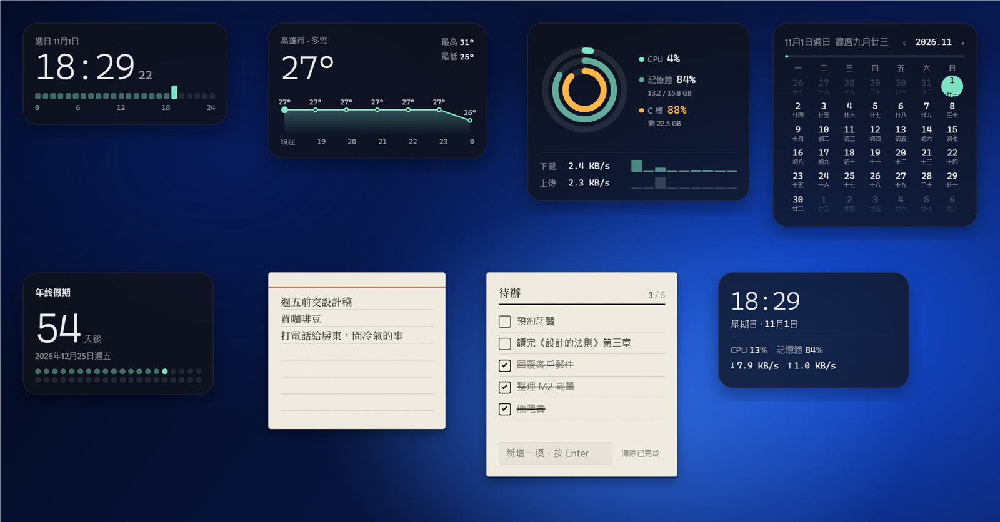

# M2 內建組件與主題 — 完成說明

日期：2026-11-01

## 結果

8 個內建組件 × 3 套主題，全部在本機實際運行驗證。主題可全局切換，也可單獨給某個組件指定。

| 量被畫出來（預設） | 玻璃上的字 | 書桌上的紙 |
|---|---|---|
|  |  |  |

混搭（便利貼、待辦用「紙」，其餘用預設）：

## 視覺方向

先看了 Apple 桌面組件、Nothing OS 和 DeskBox，提出三個方向並做成對比頁（`.oil-ui/m2-widgets/explore/style-explorer.html`）。你選擇三個都做，所以三個方向都成了正式主題：

| 主題 | 一句話 | 字體 | 顏色 |
|---|---|---|---|
| 量被畫出來 `instrument` | 每個數字都畫成看得見的量 | Cascadia Mono（數字） | 石墨玻璃 + 薄荷綠；超過 85% 只在那一處變琥珀 |
| 玻璃上的字 `type` | 沒有卡片，字直接浮在桌布上；滑鼠移上去才出現底板 | Segoe UI Variable Display 200 | 白字 + Windows 系統強調色 |
| 書桌上的紙 `paper` | 組件是放在書桌上的紙製文具 | Georgia（數字）、思源宋體（標題） | 米白紙 + 墨色 + 朱紅印章色 |

## 8 個組件

| 組件 | 量被畫出來 | 玻璃上的字 | 書桌上的紙 | 設定項 |
|---|---|---|---|---|
| 時鐘 | 24 格小時刻度 | 超大細體時間，冒號用強調色 | 星期印章；第幾天、第幾週 | 24 小時制、秒、日期、時區 |
| 日曆 | 月進度條 | 今天的大號日期 | 紅色月份線，週日紅字，今天手繪圈 | 每週第一天、農曆 |
| 天氣 | 未來 6 小時溫度曲線 | 溫度 + 兩行文字 | 印好的時 / 溫表格 | 城市（留空自動定位）、°C / °F |
| 系統監控 | 同心圓環 + 網速柱狀 | 三個大數字 | 帶點線的帳本 | 刷新頻率、磁碟 |
| 便利貼 | 字數 | 打字時才出現底板 | 紅線 + 橫格的索引卡 | 字號 |
| 待辦清單 | 完成進度條 | 剩餘項數的大數字 | 印好的勾選表，做完劃線 | 標題 |
| 倒數日 | 點陣：已過 / 剩下 | 超大天數 | 朱紅日期章 | 名稱、日期（組件內也能直接編輯） |
| 自訂資訊卡 | 模板拼內容，例如 `CPU {cpu}%` | ← 同左 | ← 同左 | 模板、對齊 |

- 天氣：Open-Meteo（免費、免 Key），城市留空時用 get.geojs.io 按網絡位置定位，再查一次中文地名；每 15 分鐘刷新，離線時顯示上次結果。
- 日曆農曆：用瀏覽器內建的中國曆法（`Intl` 的 `chinese` 曆），會正確顯示「冬月」「閏六月」等。
- 所有組件都會隨大小縮放，空間不夠時自動隱藏次要部分。

## 主程式的改動

- 主題系統：`sdk/themes/<id>/theme.json`（名稱 + 主程式需要的外觀預設）＋ `theme.css`（其餘樣式）。全局主題 + 每個組件可單獨覆蓋，即時切換、不用重新載入。
- 讀取 Windows 系統強調色（「玻璃上的字」用）。
- 語言設定：托盤 → 設定 → 語言（跟隨系統 / 繁體 / 簡體 / English），組件文字和日期格式跟着變。主程式選單仍只有繁體（M5）。
- 文字類設定的預設值可以按語言寫。
- SDK 新增 `widget.t({ "zh-TW": …, en: … })`、`widget.theme`；`base.css` 新增共用元件（`w-label`、`w-num`、`w-display`、`w-bar`、`w-input`、`w-btn`、`w-check`），主題靠變數統一換裝。
- 開發用：設定環境變量 `FULLWIDGET_DEV_ROOT=專案資料夾` 後，直接讀取原始碼裏的 `sdk/` 和 `widgets/`，改完重新載入即可。
- 命令：`theme <id>`、`theme-of <組件> <id|global>`、`lang <auto|zh-TW|zh-CN|en>`、`setting <組件> <key> <值>`，多條命令可用 `;` 連寫。

## 驗證

- 8 個組件 × 3 套主題逐一截圖檢查；修掉：小時刻度和點陣被誤隱藏、系統監控數字換行、天氣英文地名、日曆標題擠成兩行、玻璃主題系統監控留白太多。
- 實際操作：勾選待辦（已存檔）、日曆翻月、倒數日編輯表單。
- 單個組件換主題、重啟後保留；語言切換即時生效。
- 8 個組件約 163 MB（任務管理器），共用 1 個渲染進程；日誌無錯誤。
- 沒有做獨立的設計評審，只做了自查。

## 還沒做

- 時鐘的指針樣式。
- 設定表單（城市、模板等目前只能用命令或倒數日的組件內表單改）→ M3 控制中心。
- 選單換成自繪樣式（用戶反饋）。
- 「玻璃上的字」在淺色桌布上的可讀性未驗證（只測了深色桌布）。
