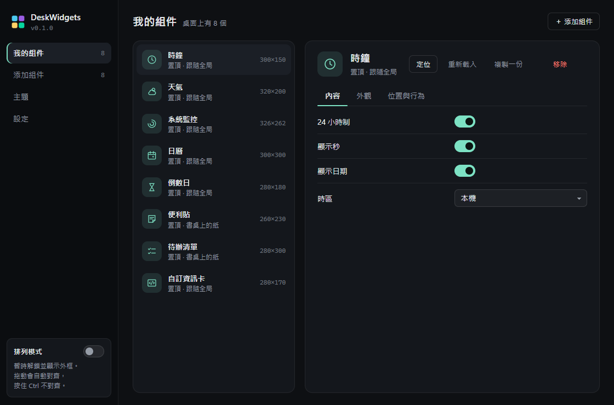
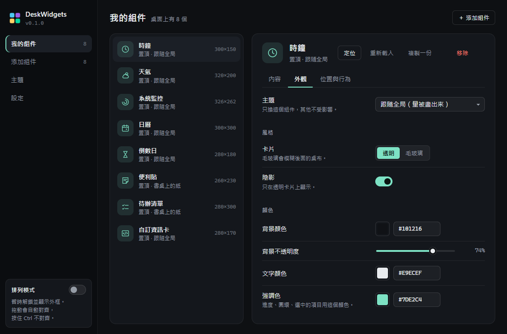
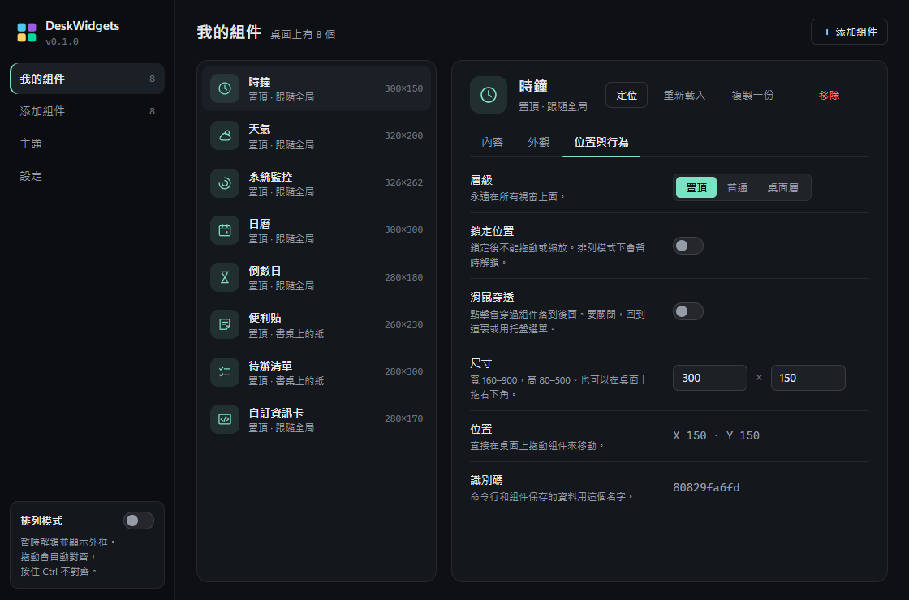
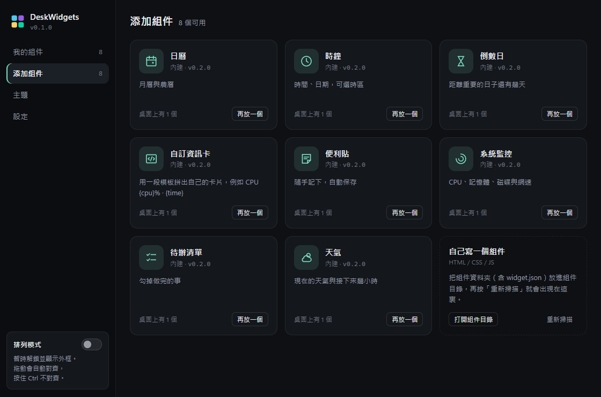
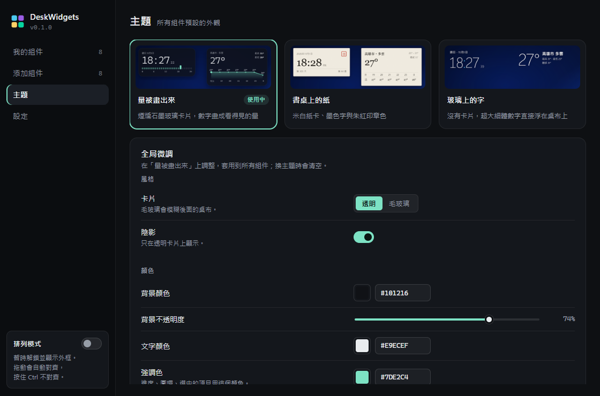
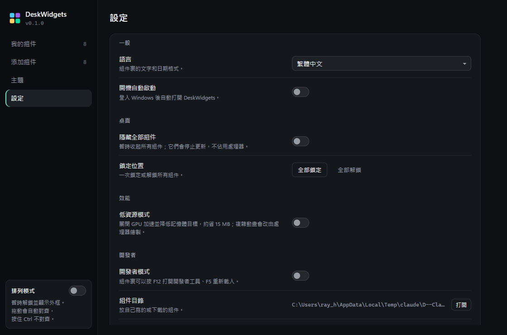
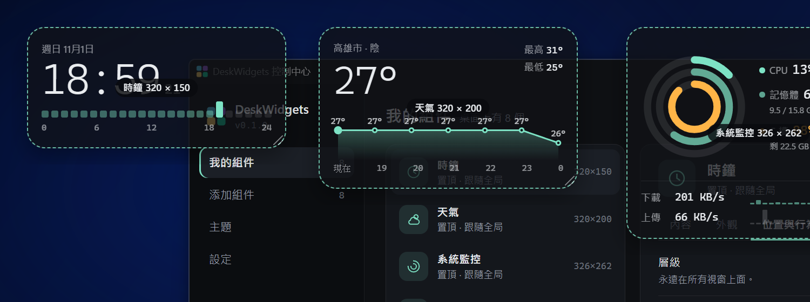
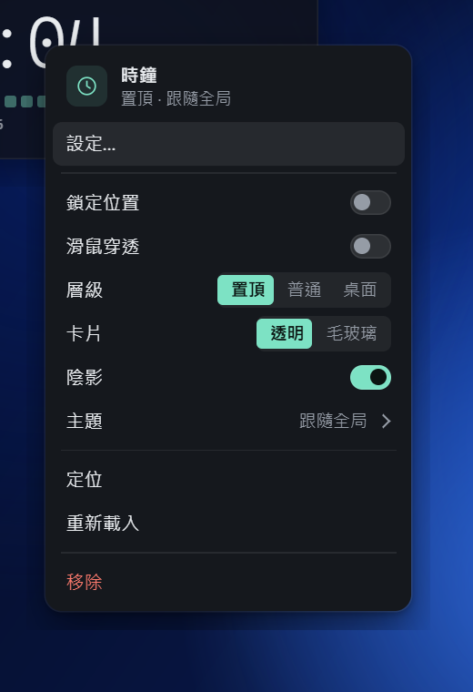
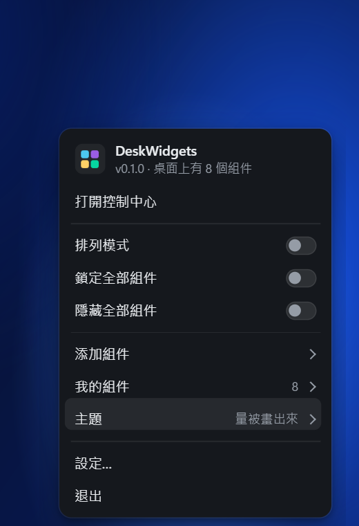
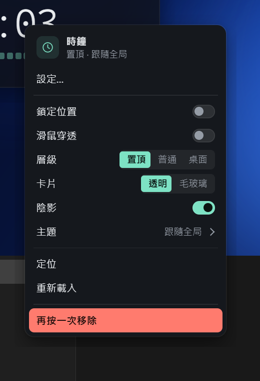

# M3 控制中心 — 完成說明

日期：2026-11-01

## 結果

不碰設定檔，就能完成所有自定義：添加 / 複製 / 移除組件、改內容設定、改外觀、換主題、調層級與尺寸、排列組件、通用設定。每個改動都即時套用到桌面上的組件。

打開方式：**左鍵點托盤圖標**，或右鍵組件 →「設定…」（直接跳到那個組件），或 `FullWidget.exe --cmd=control`。

| 我的組件 · 內容 | 外觀 | 位置與行為 |
|---|---|---|
|  |  |  |

| 添加組件 | 主題 | 設定 |
|---|---|---|
|  |  |  |

排列模式（所有組件顯示虛線外框、名稱和尺寸）：

## 四個頁面

- **我的組件**：左邊是組件列表，右邊編輯選中的組件，分三頁：
  - **內容**：按組件的 `widget.json` 自動生成表單（開關、選項、文字、數字、日期、顏色、字體）。
  - **外觀**：單獨換主題；卡片（透明 / 毛玻璃）、陰影、背景色與不透明度、文字色、強調色、字體、字號、圓角、內距、整體不透明度、自訂 CSS。改過的項目有綠點和「重設」。
  - **位置與行為**：層級、鎖定、滑鼠穿透、尺寸（可輸入）、位置、識別碼。
  - 上方動作：**定位**（讓桌面上那個組件浮到最上面並閃兩下）、重新載入、複製一份、移除（按兩下確認）。
- **添加組件**：組件庫卡片，顯示說明、版本、第三方組件需要的權限、桌面上已有幾個；「放到桌面」後可直接跳去設定它。另有「自己寫一個組件」入口（打開組件目錄、重新掃描）。
- **主題**：三套主題的實拍預覽，點一下全局切換；下方「全局微調」對所有組件生效。
- **設定**：語言、開機啟動、隱藏全部組件、全部鎖定 / 解鎖、低資源模式（需要重啟時會提示並提供按鈕）、開發者模式、組件目錄與資料位置。

## 排列模式與吸附

- 側欄的「排列模式」開關（托盤選單也有）：所有組件顯示虛線外框、名稱與尺寸，並暫時解除鎖定和滑鼠穿透；關掉控制中心時自動退出。
- **拖動吸附**（一直有效）：靠近螢幕邊緣或其他組件時，自動對齊邊緣，或保持 12 的間距並對齊頂邊。**按住 Ctrl** 可以自由擺放。

## 設計

沿用「量被畫出來」的語言：石墨灰底、唯一的薄荷綠強調色、等寬數字。組件圖標是 8 個自繪的 1.5px 直角線條圖標。

動效：
1. 操作反饋：開關像磁扣一樣「咔嗒」吸合，按鈕按下微縮，添加組件時圖標彈一下。
2. 狀態切換：側欄、組件列表、分頁、分段控件的選中底板都會滑到新位置；換組件時編輯區淡入。
3. 首次打開：側欄和內容按閱讀順序依次出現（只在第一次）。
4. 「定位」讓桌面上真實的組件亮起來。
已照顧「減少動態效果」設定。

## 測試中修掉的問題

| 問題 | 原因 / 修法 |
|---|---|
| 毛玻璃切回透明後，組件留白區和卡片都變成不透明黑色 | 關閉模糊會連帶關掉視窗透明；關閉後重新套用 DWM 框架 |
| 置頂組件的透明陰影留白會擋住後面視窗的點擊（M0 遺留） | 新增游標監看：游標在留白區時讓點擊穿過，只在滑鼠移動時檢查 |
| 置頂組件會蓋住控制中心的按鈕 | 控制中心在使用中時置頂，切到別的程式就恢復 |
| 「按住 Alt 不對齊」實際會取消整個拖動 | Alt 會中斷 Windows 的拖動流程，改用 Ctrl |
| 並排的兩個組件不會對齊頂邊 | 「是否相鄰」的判斷要把間距算進去 |
| 確認移除按鈕滑過時紅字紅底（對比 1:1） | 調整樣式優先順序 |
| 編輯區標題列被按鈕擠成兩行、描述行尾剩一兩個字 | 識別碼移到「位置與行為」、加寬標籤欄、精簡描述 |

## 驗證

實機（Win11、150% 縮放）逐項點擊並核對 `config.json`：
- 內容開關、外觀改毛玻璃與重設、層級切換、輸入尺寸、定位、添加、選中並移除、全局主題切換、隱藏全部、排列模式、拖動吸附、Ctrl 自由擺放 —— 全部生效。
- 用命令改組件時，打開中的控制中心即時更新。
- 四個頁面以真實狀態在無頭瀏覽器截圖，沒有控制台錯誤、溢出或載入失敗；對比度檢查通過。
- 日誌沒有錯誤。沒有做獨立的設計評審，只做了自查。

## 沒驗證 / 還沒做

- 托盤圖標左鍵打開控制中心：程式碼很簡單，但沒有實際點擊測試（需要定位托盤圖標）。
- 語言選單（原生下拉）、顏色選擇器彈窗、字體清單：已實作，未逐一實機點擊。
- 控制中心介面目前只有繁體中文（M5 多語言）。
- 右鍵選單和托盤選單仍是 Windows 原生樣式（你要求日後替換，仍在待辦）。

## 附：新選單（取代 Windows 原生選單）

右鍵組件和托盤右鍵的選單，改成和控制中心同一套樣式的自繪選單。

| 組件右鍵 | 托盤 | 托盤 → 主題 | 移除確認 |
|---|---|---|---|
|  |  |  |  |

- **常用開關直接在選單裏**：鎖定、穿透、陰影是開關，層級和卡片是分段按鈕；切換後選單不關，立即看到結果。
- **長清單滑入成第二頁**（添加組件、我的組件、主題），頂部有返回。
- **關閉方式和原生一樣**：Esc、點別處、切到別的視窗；鍵盤 ↑↓ 選擇、Enter 執行、→ 進入下一頁、← 返回、分段按鈕用 ← → 切換。
- **移除要按兩次**：第一次變成紅色「再按一次移除」。
- 選單視窗在啟動時就在背景建好，打開沒有延遲。
- 動效：卡片從開啟方向落下（0.18 秒）；一塊高亮底板跟着游標或鍵盤滑動；開關「咔嗒」；分段按鈕的底板滑動；第二頁從右滑入、卡片高度跟着變。
- 托盤選單簡化了：語言、開機啟動等設定改成「設定…」直接打開控制中心的設定頁。

實機驗證：右鍵打開、開關與層級即時生效且選單不關、主題頁滑入與返回、Esc 與點別處關閉、鍵盤操作、兩次確認移除、托盤「設定…」跳到設定頁。托盤圖標本身的點擊沒有實測（用命令代替了托盤點擊來打開）。

測試中順手修了：設定檔被其他程式短暫打開時保存失敗的問題（現在會重試，最後直接寫入）。

## 給開發者

- 控制中心頁面在 `ui/control-center/`（純 HTML/CSS/JS），主程式端在 `src/FullWidget/Windows/ControlCenter.cs` 和 `Bridge/ControlBridge.cs`。
- 狀態：主程式每次設定變動後推送完整狀態；頁面用就地合併（morph）更新，不會打斷正在輸入或拖動的控件。
- `FullWidget.exe --cmd="dump-state 路徑"` 可匯出控制中心看到的狀態，方便離線調整介面。
