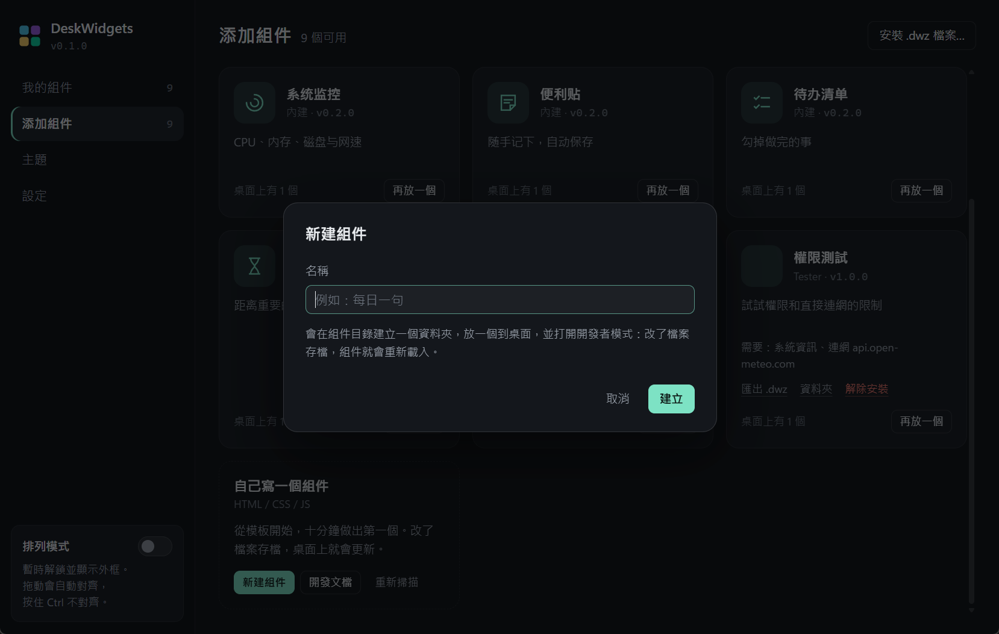
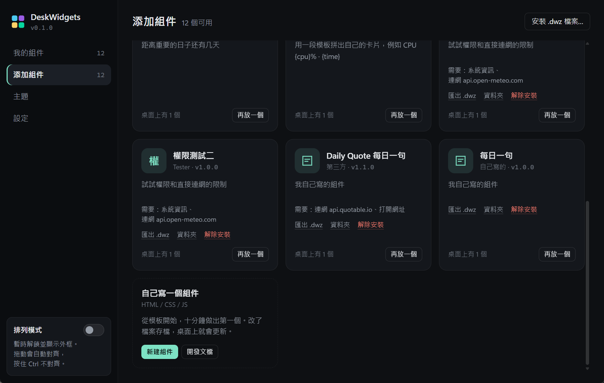
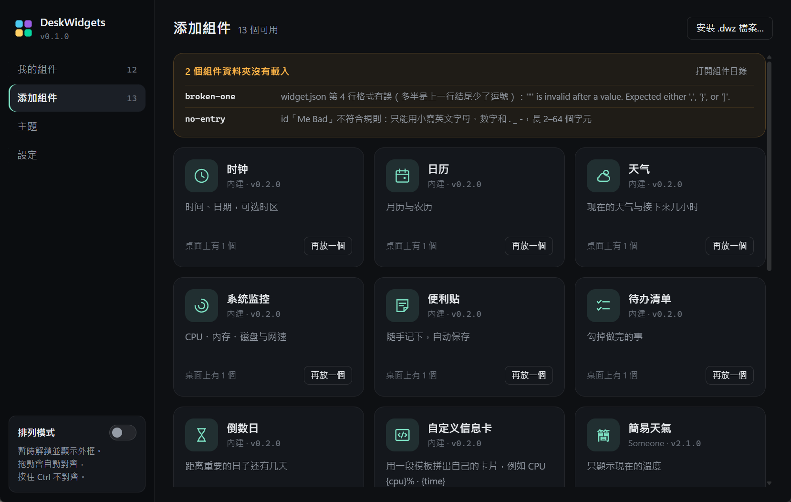
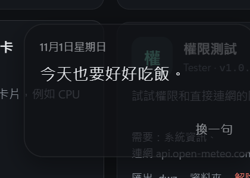
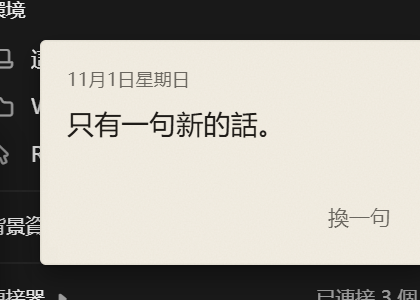
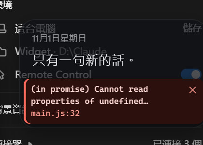
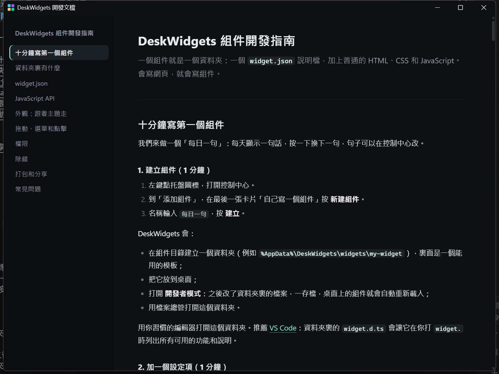

# M4 給開發者的功能 — 完成說明

日期：2026-11-01

## 結果

照著[組件開發指南](組件開發指南.md)，可以在十分鐘內寫出一個組件：教程裏的「每日一句」，我用一個腳本把指南裏的代碼原樣貼進新建的組件，組件直接可用，設定、保存、換主題都照指南說的那樣運作。

M4 做了這些：

| 功能 | 怎麼用 |
|---|---|
| 新建組件 | 控制中心「添加組件」→「自己寫一個組件」→ 新建組件。從模板建立資料夾、放到桌面、打開開發者模式和資料夾。 |
| 存檔即重新載入 | 開發者模式下，組件資料夾裏的檔案存檔後，用到它的組件自動重新載入；改了 `widget.json` 會重新讀取尺寸和設定項；新放進來的資料夾自動出現。 |
| 錯誤提示 | 開發者模式下，腳本出錯時卡片底部顯示錯誤和位置，點一下打開開發者工具。 |
| 載入失敗的資料夾 | `widget.json` 寫錯時，「添加組件」頁頂部列出資料夾、行號和原因，常見錯誤附白話提示。 |
| 權限確認 | 別人的組件要用系統資訊、連網或打開網址時，安裝或放上桌面前先列出來請用戶允許；更新後多要的權限要再允許一次。 |
| 連網限制 | 組件只能連到允許的網站：不只 `widget.fetch`，頁面直接載入的圖片、腳本、`fetch()` 也一樣。 |
| .fwz 匯出 / 安裝 / 解除安裝 | 匯出用 Windows 的存檔視窗；安裝可以雙擊、拖到控制中心、或按「安裝 .fwz 檔案…」；解除安裝要按兩次，資料夾移到資源回收筒。 |
| 雙擊安裝 | 啟動時把 `.fwz` 檔案類型關聯到 FullWidget（只寫目前用戶的登錄，不需要管理員）。設定裏可以關掉。 |
| 型別定義 | `sdk/widget.d.ts`，新建組件時一起複製，VS Code 會提示 `widget.` 的所有用法。 |
| 開發文檔 | `docs/組件開發指南.md`。控制中心裏打開時，用一個和控制中心同風格的閱讀視窗顯示，左邊目錄跟著閱讀位置移動，每段代碼有「複製」按鈕。 |

## 畫面

| 允許權限 | 更新（新權限標「新」） | 安裝失敗 |
|---|---|---|
|  |  |  |

| 新建組件 | 添加組件（第三方組件的工具列） | 載入失敗的資料夾 |
|---|---|---|
|  |  |  |

| 教程做出來的組件 | 換成紙本主題 | 開發者模式的錯誤提示 |
|---|---|---|
|  |  |  |

開發文檔閱讀視窗：

## 設計

- 所有新對話框（安裝、允許權限、新建組件、安裝失敗）都是控制中心裏自己畫的，不用 Windows 訊息框；Esc 和點外面會取消，Tab 不會跑出對話框。只有選檔案和存檔用 Windows 自己的檔案視窗。
- 權限用白話寫：「讀取系統資訊」「連到 api.open-meteo.com」「打開網址」，每項一句說明；「連到任何網站」用警告色。不認得的權限淡化顯示，並說明會被忽略。
- 安裝對話框按版本換說法：安裝、更新、重新安裝、換回舊版本。
- 解除安裝和移除一樣要按兩次。
- 沒有圖標的組件，用名稱的第一個字當圖標。

## 實機驗證（Win11、150% 縮放，獨立測試資料夾）

- **權限**：未允許時 `widget.fetch` 被拒並說明原因、頁面直接 `fetch()` 被擋；在控制中心按「查看並允許」後，允許的網站兩種方式都通、沒聲明的網站仍然被擋、系統資訊開始送達。8 個內建組件在新的連網限制下全部正常顯示，沒有任何違規記錄。
- **托盤添加**：從托盤選單添加需要權限的組件，會先打開控制中心的允許對話框，沒同意前不會放上桌面。
- **新建組件**：建立資料夾、放到桌面、開發者模式打開、檔案總管打開。
- **重新載入**：改 `main.js` → 組件重新載入；改 `widget.json` 加設定項 → 新設定項立即出現；改 SDK → 全部組件重新載入；新放進的資料夾自動出現。
- **錯誤提示**：同步錯誤和 Promise 錯誤都顯示訊息和位置；點提示會打開開發者工具。
- **匯出**：用存檔視窗匯出，內容只有組件檔案。
- **安裝**：用命令行參數（等同雙擊）安裝、拖放安裝、更新（新權限標示正確、實例保留、權限更新）、換回舊版本的說法。
- **壞檔案**：不是組件的 zip、含 `../` 路徑的 zip 都被拒絕並說明原因，沒有檔案寫到外面，暫存資料夾清乾淨。
- **檔案關聯**：在設定打開後登錄正確，用 Windows 打開 `.fwz` 會直接出現安裝對話框；關掉後登錄完全移除。
- **教程**：用腳本從指南裏抽出代碼原樣套用，組件顯示正確；真實滑鼠點「換一句」會換句並保存，重新載入後保留；在控制中心改句子，桌面即時更新；換主題正常。

## 測試中修掉的問題

| 問題 | 修法 |
|---|---|
| 每個組件頁面都有一條 404（瀏覽器自動要 favicon） | 回應空內容，開發者工具不再有雜訊 |
| 錯誤提示太長時，最有用的「檔案:行號」被截掉 | 位置單獨一行，訊息最多兩行 |
| 安裝或新建後組件多重新載入一次 | 程式自己改的資料夾，短時間內不觸發重新載入（而且要在寫入前就設好） |
| 安裝舊版本的檔案時對話框仍寫「更新」 | 按版本號比較，分成安裝 / 更新 / 重新安裝 / 換回舊版本 |
| 「需要：…連網 api.open-meteo.com」在網址中間斷行 | 每個權限名稱不拆開 |
| 沒有圖標的組件顯示成空白方塊 | 用名稱第一個字 |
| 對話框說明最後一行只剩一兩個字 | 段落改用平衡換行 |
| 開發文檔用系統預設程式打開，看到的是原始 Markdown | 改成自己的閱讀視窗 |
| 教程代碼有幾行太長，閱讀視窗要橫向捲動 | 拆短，並把行尾註解移到上一行 |

## 沒驗證 / 要知道的

- **你的電腦會被登記 `.fwz` 檔案類型**：下次用正常方式（不帶 `--data-dir`）啟動 FullWidget 時，它會把 `.fwz` 關聯到自己（只寫目前用戶的登錄）。測試時我只在測試資料夾裏打開又關掉，現在登錄是乾淨的。
- **資源回收筒裏有兩個測試資料夾**（`user.daily-quote`），是測試解除安裝和更新時移進去的，可以直接清掉。
- 真正用滑鼠在檔案總管雙擊 `.fwz`：用 Windows 的「打開」測過（同一條路），沒有真的去雙擊圖標。
- 把檔案從檔案總管拖到控制中心：用開發者工具協定模擬了拖放，沒有用真實滑鼠從檔案總管拖。
- 「十分鐘」是按步驟估的：代碼是腳本貼的，沒有找人照著做計時。
- 組件裏的文字目前跟著系統語言；這台電腦是簡體中文，所以內建組件顯示簡體（M5 多語言時一起處理）。

## 給開發者

- 新增的程式：`Core/Permissions.cs`（權限與連網限制）、`Core/Packages.cs`（.fwz）、`Core/HotReload.cs`、`Core/Scaffold.cs`（新建組件）、`Shell/FileAssociation.cs`、`Windows/DocsWindow.cs`。
- 新增的頁面與資源：`ui/docs/`（文檔閱讀）、`templates/hello-widget/`、`sdk/widget.d.ts`、`docs/組件開發指南.md`。
- 新命令：`devmode on|off`、`new-widget 名稱`、`export <組件> <檔案>`、`uninstall <組件>`、`guide`；`FullWidget.exe 檔案.fwz` 直接安裝。
- 設定檔新欄位：`grants`（每個第三方組件允許的權限）、`ownWidgets`（用「新建組件」建立的）、`fileAssociation`。
