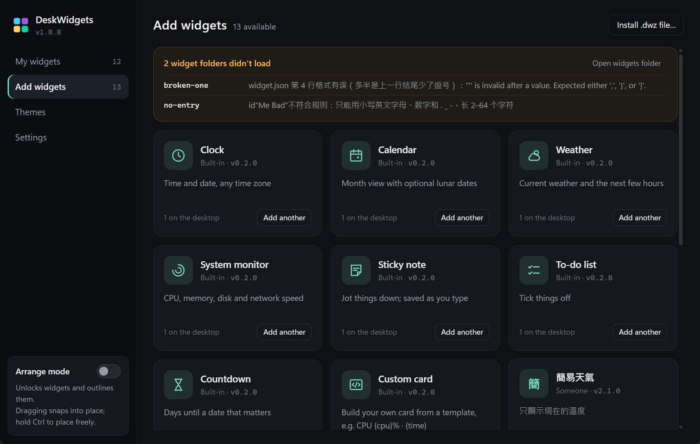
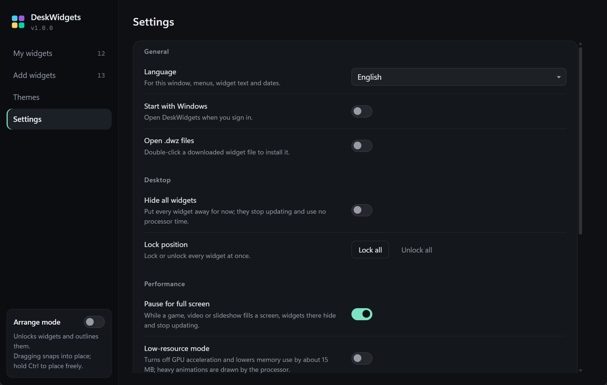
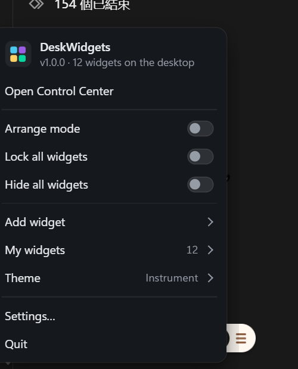
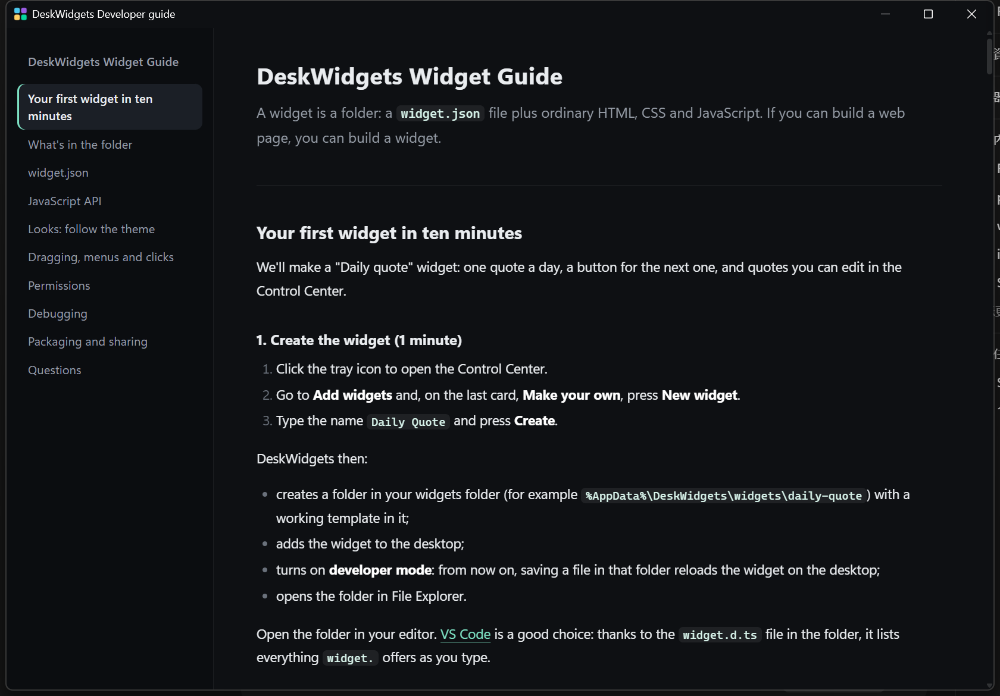

# M5 打磨發佈 — 完成說明

日期：2026-11-01

## 結果

FullWidget 1.0.0 可以交給別人用了：解壓就能執行的 zip、三種介面語言、全螢幕時自動讓開、可靠的開機啟動，以及刪除前的清理命令。

`build\publish.ps1` 會在 `dist\` 做出兩個 zip：

| 檔案 | 大小 | 需要 |
|---|---|---|
| `FullWidget-1.0.0-win-x64.zip` | 0.9 MB | .NET 9 桌面執行階段（沒有的話第一次打開時 Windows 會提示下載） |
| `FullWidget-1.0.0-win-x64-full.zip` | 45 MB | 什麼都不用裝 |

兩個都需要 WebView2 Runtime（Windows 11 已內建）。zip 裏附 `README.md`（中英文）：怎麼開始、資料放在哪、便攜模式、怎麼移除。

## 做了什麼

### 全螢幕時暫停
- 玩遊戲、看全螢幕影片或簡報時，那個螢幕上的組件會隱藏並停止工作（頁面暫停、不再收系統數據）；結束後自動回來。其他螢幕上的組件照常。
- 「置頂」的組件因此不會擋在遊戲上面。
- 只把真正的全螢幕視窗算進來：最大化的普通視窗、有標題列的視窗、桌面本身都不算（即使工作列設成自動隱藏）。
- 設定 → 效能 →「全螢幕時暫停」，預設開。

### 三種語言
- 繁體中文、簡體中文、English。預設跟隨 Windows 的顯示語言，可在設定裏改；控制中心、托盤和右鍵選單、對話框、錯誤訊息、組件、開發文檔和「新建組件」的模板一起切換。
- 控制中心用一張對照表（`ui/control-center/i18n.js`），每一行是繁中、簡中、英文；主程式的文字在 `Shell/Strings.cs`，同樣三種並排。
- 簡體中文用大陸的說法（设置、文件夹、鼠标、卸载、回收站），不是逐字轉換。
- 英文版開發文檔 `docs/widget-guide.en.md`；簡體中文讀者使用繁體版。
- 其他語言的 Windows 顯示英文。

| English | 简体中文 |
|---|---|
|  |  |
|  |  |

| 托盤選單（English） | 開發文檔（English） |
|---|---|
|  |  |

### 交給別人時用得到的
- **程式圖標**：exe 有四色方塊圖標（`build\make-icon.ps1` 畫出 16–256 px 共 9 個尺寸），`.fwz` 檔案也用它。版本 1.0.0，檔案資訊寫好產品名稱。
- **第一次打開**：放好時鐘、天氣、系統監控，托盤彈出一句提示：左鍵打開控制中心，右鍵打開選單。
- **便攜模式**：在 `FullWidget.exe` 旁邊放一個名為 `portable` 的空檔案，所有資料就存在旁邊的 `data` 資料夾，適合隨身碟。
- **開機啟動跟着程式走**：把程式資料夾搬走後，開機啟動的記錄如果還指向舊位置（那裏已經沒有程式），打開時會自動改成新位置。若舊位置還有另一份 FullWidget，就不動它。
- **移除前清理**：`FullWidget.exe --cleanup` 把它從開機啟動和 `.fwz` 檔案類型中拿掉，然後就可以直接刪資料夾。

## 實機驗證（Win11、150% 縮放）

- **全螢幕**：另一個程式開一個無邊框全螢幕視窗 → 12 個組件全部隱藏 → 關掉後全部回來；開一個最大化的普通視窗 → 組件不受影響。
- **語言**：測試資料夾裏切到 English 和簡體中文，控制中心各頁、托盤選單、開發文檔、新建組件的模板都換了語言；載入失敗的組件訊息也跟着換。
- **英文教程**：用 English 介面新建「Daily Quote」，照英文文檔把代碼原樣貼進去，組件正常顯示。
- **發佈包**：小 zip 和完整 zip 都解壓到新資料夾、用便攜模式打開：資料寫在程式旁邊、預設佈局出現、沒有寫任何登錄。完整版不依賴本機安裝的 .NET 也能啟動（這台電腦有裝 .NET，所以只能確認它用的是自帶的那份）。
- **開機啟動**：把啟動記錄改成指向不存在的位置 → 打開程式後自動改到目前的 exe；`--cleanup` 之後記錄和檔案類型都被移除。登錄回到測試前的樣子（原本就沒有 FullWidget 的記錄）。
- 編譯 0 錯誤 0 警告。

## 測試中修掉的問題

| 問題 | 修法 |
|---|---|
| 自動隱藏工作列時，最大化的普通視窗也會被當成全螢幕 | 排除最大化和有標題列的視窗 |
| 「載入失敗」的訊息停留在啟動時的語言 | 換語言時重新讀取組件目錄 |
| 英文的排列模式說明沿用中文的斷行，變得很碎 | 英文不強制斷行 |
| 「15 MB」在數字和單位之間斷行 | 不斷行空格 |
| 英文教程有一行代碼太長要橫向捲動 | 縮短提示文字 |
| 發佈包裏有用不到的 IntelliSense 檔案和 WPF 元件 | 打包時移除 |

## 沒驗證 / 要知道的

- **Windows 10**：沒有測試。
- **沒有 .NET 的電腦上打開小 zip**：沒有找乾淨的電腦測試 Windows 的下載提示。
- **其他語言**：只做了三種；其他語言的 Windows 顯示英文。
- **安裝程式**：沒做（zip 解壓即用）。也沒有自動更新、沒有程式碼簽章，所以第一次打開時 Windows SmartScreen 可能提示「未知的發行者」。
- **你的電腦**：這次測試沒有改動你的登錄。你自己用正常方式打開 FullWidget 時，它會像 M4 說明的那樣登記 `.fwz` 檔案類型。

## 給開發者

- 發佈：`powershell -ExecutionPolicy Bypass -File build\publish.ps1`。圖標：`build\make-icon.ps1`（改了 Logo 再跑一次）。
- 新增：`Shell/Strings.cs`（三語）、`ui/control-center/i18n.js`、`docs/widget-guide.en.md`、`templates/hello-widget.en`、`templates/hello-widget.zh-CN`、`README.md`。
- 設定檔新欄位：`pauseOnFullscreen`。命令行新增 `--cleanup`。
- 加新的介面文字：控制中心在 `i18n.js` 加一行三語；主程式在 `Strings.cs` 加一個 `T("繁", "简", "English")`。
