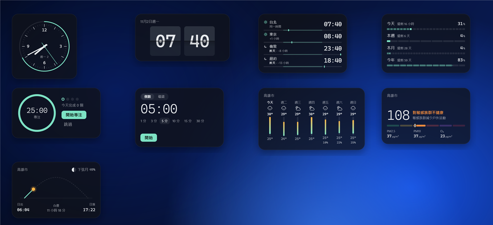
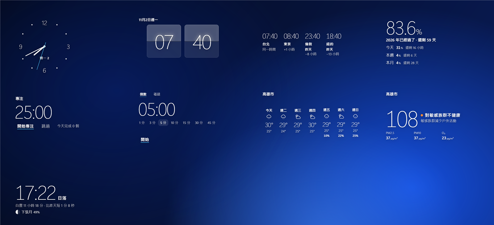
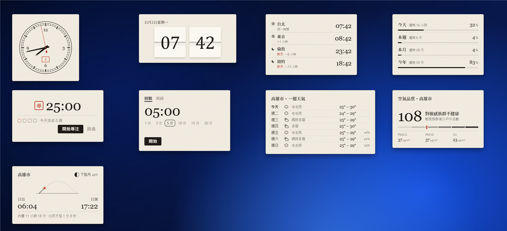
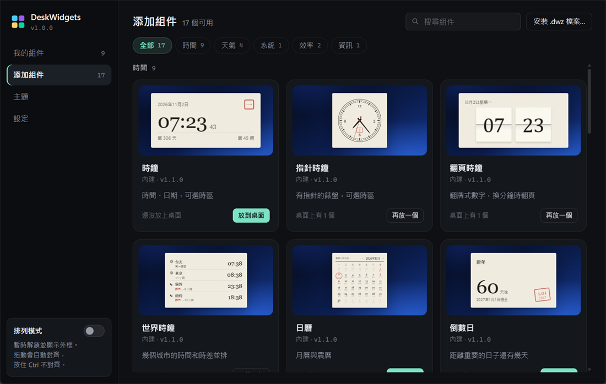
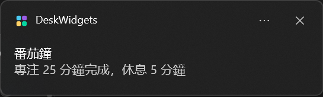

# M6 時間與天氣 — 完成說明

日期：2026-11-02

## 結果

內建組件從 8 個變成 17 個：時間類加了 6 個，天氣類加了 3 個。組件多了以後，「添加組件」頁改成按分類找，也可以搜尋，每張卡片上有組件的預覽圖；托盤的「添加組件」也按分類分成幾頁。番茄鐘和計時器用新的通知功能提醒你時間到了，組件被全螢幕暫停時也會準時。

| 分類 | 組件（粗體是新的） |
|---|---|
| 時間（9） | 時鐘、**指針時鐘**、**翻頁時鐘**、**世界時鐘**、日曆、倒數日、**番茄鐘**、**計時器**、**時間進度** |
| 天氣（4） | 天氣、**一週天氣**、**空氣品質**、**日出日落** |
| 系統（1） | 系統監控 |
| 效率（2） | 便利貼、待辦清單 |
| 資訊（1） | 自訂資訊卡 |

9 個新組件（左上起：指針時鐘、翻頁時鐘、世界時鐘、時間進度、番茄鐘、計時器、一週天氣、空氣品質、日出日落）：

**量被畫出來**

**玻璃上的字**

**書桌上的紙**

| 添加組件頁（目前主題是「書桌上的紙」，預覽圖跟着變） | 番茄鐘的通知 |
|---|---|
|  |  |

## 9 個新組件

每個都有三套主題的樣子、三種語言，空間不夠時會收起次要的部分。

| 組件 | 量被畫出來 | 玻璃上的字 | 書桌上的紙 | 設定項 |
|---|---|---|---|---|
| 指針時鐘 | 外圈隨這一小時的分鐘填滿，秒針「嗒」地跳 | 十二個點和細指針，沒有錶盤 | 印刷錶盤、鐵路分鐘刻度、墨色指針、朱紅日期窗 | 秒針、數字（不顯示 / 12·3·6·9 / 全部）、日期、時區 |
| 翻頁時鐘 | 石墨翻牌、等寬數字 | 毛玻璃翻牌、細體數字 | 米白紙牌、襯線數字 | 24 小時制、秒、日期 |
| 世界時鐘 | 每個城市一條 24 小時軌：白天亮、現在一個刻度 | 城市排成幾欄大號細字 | 印好的時刻表，日期不同時「明天 / 昨天」用朱紅 | 24 小時制、時差。城市在組件上按「編輯」增刪（最多 8 個，內建 56 個城市，中英文都能搜） |
| 番茄鐘 | 圓環隨時間變短，四個點表示這一輪的第幾個 | 大號分秒 | 「專」「休」印章，方格記輪數 | 專注、休息、長休息的分鐘數，幾輪長休息一次，自動開始，通知，提示音 |
| 計時器 | 倒數時進度條變短，顯示幾點結束；碼錶計次，最快綠、最慢琥珀 | 大號細字 | 印好的計次表 | 通知、提示音。時間可點一下直接輸入（`90`、`5:30`、`1:05:00`） |
| 時間進度 | 今天 24 格、本週 7 格、本月按天數、今年 12 格，正在走的那格逐漸填滿 | 今年過了多少的大號百分比 | 帳本式細線 | 要顯示的項目、每週第一天 |
| 一週天氣 | 每天一根溫度條，七天共用一把尺 | 每天的最高溫大號細字 | 印好的一週表格 | 城市（留空自動定位）、°C / °F |
| 空氣品質 | 六級色階和目前位置 | 數字加一個顏色點 | 由淺到深的墨色色階、朱紅標記 | 城市、指標（美國 AQI / 歐洲 AQI） |
| 日出日落 | 太陽在地平線上的弧，走過的一段亮起 | 下一次日出或日落的時間 | 曆書式兩欄 | 城市、月相 |

- **天氣類的數據**：一週天氣和空氣品質來自 Open-Meteo（免費、不用帳號）；日出日落和月相在本機計算，只在查城市座標時連網。都和「天氣」組件一樣，留空城市時按網絡位置定位，離線時顯示上次的結果。
- **城市名稱**：Open-Meteo 的城市搜尋不太認得中文：「台中」找不到、「高雄」會找到中國大陸的一個村、「东京」找到的不是東京。現在四個天氣類組件共用 `sdk/places.js`：常用的 119 個城市（台灣各縣市、港澳、大陸主要城市、亞洲和歐美大城市；繁簡寫法共 195 個名稱）先換成英文名再查；其他名稱會連「市」一起試，取人口最多的那個。組件上顯示的是你輸入的名稱。找不到時直接說找不到，不再默默顯示舊的城市。原有的「天氣」組件也一起修好了。
- **空氣品質的等級名稱**：繁體用台灣環境部的說法（良好、普通、對敏感族群不健康…），簡體用中國的說法（优、良、轻度污染…）。

## 通知

番茄鐘和計時器時間到了，螢幕角落會彈出 Windows 通知（從 FullWidget 發出）。

- 時間由主程式計，不靠組件頁面：組件被全螢幕暫停、按了「隱藏全部組件」、頁面重新載入，通知都照樣準時。
- 番茄鐘開啟「自動開始休息」時，專注結束和休息結束的通知一開始就排好。
- 電腦睡眠醒來時，遲了 15 分鐘以上的通知不再顯示。
- 第三方組件也能用：聲明 `notify` 權限，用 `widget.notify(...)`；文檔已更新。

## 組件庫

- **分類**：全部、時間、天氣、系統、效率、資訊、媒體與裝飾（M9 起有組件）、其他（沒寫分類的第三方組件）。「全部」按分類分段顯示。
- **搜尋**：名稱、說明和識別碼都能搜，三種語言的名稱都算（例如在中文介面輸入 clock 也找得到時鐘）。
- **預覽圖**：每張卡片上方是組件在你目前主題、目前語言下的樣子，襯在一張深藍桌布上。預覽圖由 `build/make-previews.mjs` 實際打開每個組件拍下來，每個組件 9 張（3 主題 × 3 語言）。
- **托盤選單**：「添加組件」先選分類，再選組件，選單不會長過螢幕。

## 其他改動

- 新的 CSS 變數 `--w-bg-solid`：卡片顏色但不透明，用在下拉清單這類要擋住後面內容的地方。
- 內建組件的版本統一為 1.1.0。
- 第三方組件的 `widget.json` 可以寫 `category` 和 `preview`，文檔已說明。

## 效能

這次逐一量了每個組件的處理器用量，發現每秒更新的東西加了過渡動畫，畫面幾乎一直在重畫：

| 組件 | 修之前 | 修之後 |
|---|---|---|
| 系統監控（預設佈局就有，M2 起一直如此） | 約 22% 的一個核心 | 約 1% |
| 指針時鐘（秒針「嗒」一下的回彈動畫） | 約 6% 的一個核心 | 和數字時鐘一樣，不到 0.2% |

- 系統監控的圓環和進度條、指針時鐘的秒針回彈、番茄鐘圓環和閃爍的點、計時器的進度條都改成不加動畫；計時器「時間到」只閃 8 次。看起來的差別很小。
- 指針時鐘的錶盤只畫一次，指針放在獨立的圖層上轉，錶盤每分鐘才重畫一次。
- 番茄鐘沒在跑的時候每分鐘才更新一次。
- **17 個組件全部放上桌面：處理器約 0.2%（全部 14 個核心合計），記憶體約 246 MB（任務管理器）。**
- 開發文檔加了一節「省電：每秒更新的東西不要加動畫」，提醒寫組件的人。

## 實機驗證（Win11、150% 縮放）

- **9 個新組件 × 3 套主題 × 3 種語言**都實際放上桌面看過。修掉：翻頁時鐘的紙本數字（Georgia 的舊式數字掉到摺線下面，改用 Cambria）、翻牌太小、世界時鐘在「玻璃上的字」城市名被截斷、計時器的預設時間換到第二行露出半截、空氣品質和日出日落的英文被截斷、日出日落「紙」主題中間一大片空白（加上墨線畫的太陽軌跡）。
- **通知**：預約一則 9 秒後的通知，再按「隱藏全部組件」→ 通知準時出現（截圖如上）。番茄鐘專注設成 1 分鐘、隱藏全部組件後等它結束 → 回來時已記下完成 1 個、休息已自動開始（那次通知沒截到圖）。計時器 4 秒倒數 → 顯示「時間到」並發出通知（日誌有記錄）。
- **番茄鐘**：開始、暫停、繼續、重設、跳過；今天完成的數量；重新載入後接着計時。
- **世界時鐘**：在組件上增刪城市（中英文都能搜，例如「巴」找到巴黎）。
- **組件庫**：分類切換、搜尋（中文介面輸入 clock 找到 4 個時鐘，輸入「通知」找到番茄鐘和計時器，找不到時顯示說明）；預覽圖隨主題、語言切換；托盤「添加組件 → 時間」列出 9 個。
- **城市**：預覽圖用的台北、上海、London 在組件裏定位正確；台中、高雄、新竹、伯斯、華盛頓等用同樣的查法另外驗證過。
- 編譯 0 錯誤。

## 沒做 / 要知道的

- **預覽圖要重拍**：改了組件的樣子後，執行 `node build/make-previews.mjs [組件 id…]` 重新拍（約 20 秒一個組件；天氣類顯示拍攝當時的真實天氣）。17 個組件共 153 張、約 1.3 MB；38 個時約 3 MB。
- `sdk/places.js` 目前只給內建組件用，沒寫進開發文檔；第三方組件要用的話，以後再當作正式功能說明。
- 計時器、番茄鐘的提示音只在組件沒被暫停時響；暫停時靠 Windows 通知。
- 托盤選單的分類頁沒有截圖（截圖時背景有其他視窗）。

## 給開發者

- 新檔案：`Shell/Notifier.cs`（通知）、`Core/Categories.cs`（分類）、`Core/Previews.cs`（預覽圖網址）、`sdk/places.js`（城市定位）、`build/make-previews.mjs` + `build/previews.json`（拍預覽圖和示範內容）。
- `widget.json` 新欄位：`category`、`preview`。新權限：`notify`。新 API：`widget.notify(...)`、`widget.notify.cancel(tag)`。新 CSS 變數：`--w-bg-solid`。
- 命令行 `--cmd="…"` 以前會把命令最後一個引號也去掉（例如 `setting x city "台北"` 變成 `"台北`），已修正：只去掉包住整條命令的那一對引號。
