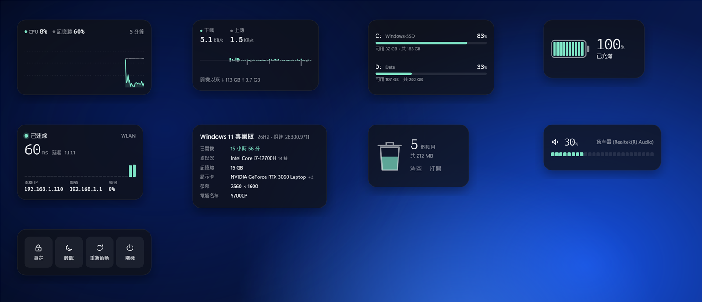
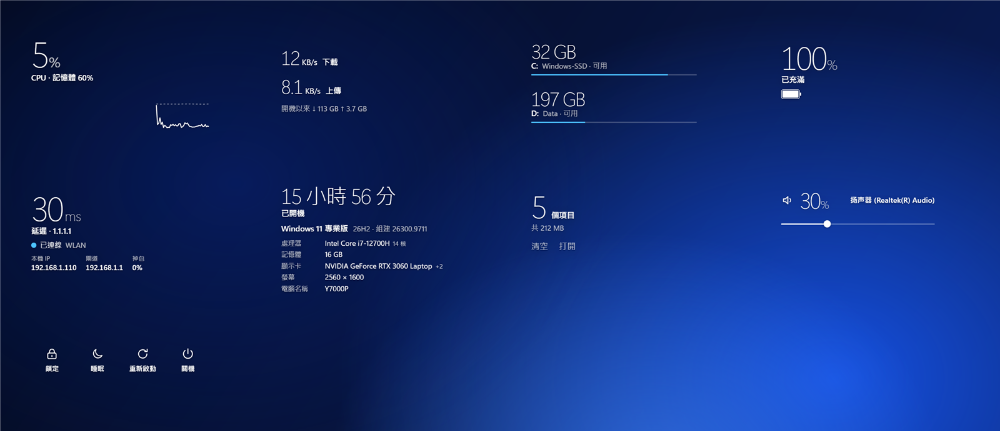
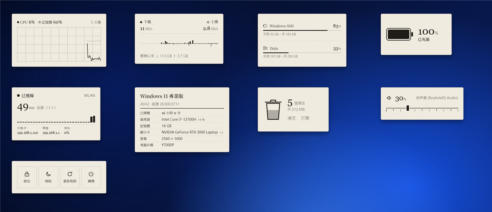
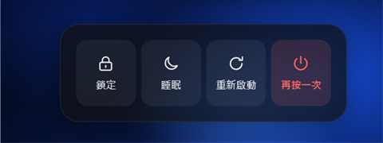

# M7 系統 — 完成說明

日期：2026-11-02

## 結果

內建組件從 17 個變成 26 個：系統類加了 9 個。主程式新增讀取電腦資訊、網路介面、延遲、系統音量、資源回收筒和電源操作的能力。電源和清空回收筒只開放給內建組件，別人寫的組件用不了。

| 量被畫出來 |
|---|
|  |

| 玻璃上的字 |
|---|
|  |

| 書桌上的紙 |
|---|
|  |

（左上起：使用曲線、網速、磁碟、電池、網路狀態、電腦資訊、資源回收筒、音量、電源）

## 9 個新組件

| 組件 | 量被畫出來 | 玻璃上的字 | 書桌上的紙 | 設定項 |
|---|---|---|---|---|
| 使用曲線 | CPU 曲線加面積、記憶體灰線；超過 85% 變琥珀 | 大號 CPU 百分比和一條細線 | 方格紙上的墨線 | 顯示多久（1 / 5 / 15 分鐘）、記憶體 |
| 網速 | 最近 60 秒的柱狀：下載向上、上傳向下 | 兩個大號速度 | 帳本式兩欄 | 單位（MB/s 或 Mbps） |
| 磁碟 | 每個磁碟一條進度，剩不到 10% 變琥珀 | 剩餘空間的大號數字 | 帳本 | 是否包括隨身碟和記憶卡 |
| 電池 | 十格電池 | 大號百分比和小電池 | 墨線電池，低電量朱紅 | — |
| 網路狀態 | 最近 30 次延遲的柱狀，慢的琥珀、掉包紅色 | 大號延遲 | 站點記錄 | 測延遲的位址（簡中預設阿里 DNS 223.5.5.5）、多久測一次、對外 IP（預設關） |
| 電腦資訊 | 版本、處理器、記憶體、顯示卡、螢幕、電腦名稱、已開機 | 已開機多久的大號字 | 規格標籤 | 電腦名稱、顯示卡 |
| 資源回收筒 | 回收筒裏的「水位」按大小升高 | 大號項目數 | 墨線廢紙簍 | — |
| 音量 | 25 格音量條 | 細線和圓鈕 | 墨線刻度尺和滑塊 | 滾動一格調多少 |
| 電源 | 四個按鈕 | 圖標和字 | 印刷按鍵 | 要顯示哪幾個（鎖定、睡眠、重新啟動、關機、登出） |

### 不會誤按的設計

- **清空回收筒**：第一下只會變成「再按一次清空」，4 秒內再按才清空。清空是永久刪除，所以這樣設計。
- **電源**：鎖定按一下就執行（不會丟資料）；睡眠、重新啟動、關機、登出要在 3 秒內按第二下，按鈕變紅並有一條倒數的線。

### 細節

- **音量**：調音量鍵、在工作列調音量、插上耳機時，組件馬上跟着變（Windows 主動通知，不是每秒去問）。在組件上滾動滑鼠滾輪就能調，鍵盤方向鍵也行。
- **使用曲線、網速**：新放上桌面或重新載入時，會先畫出最近幾分鐘的數據（主程式在有組件顯示系統數據時會記下最近 15 分鐘），不是從一片空白開始。
- **電腦資訊**：處理器名稱去掉 (R)、(TM) 等字；筆電有兩張顯示卡時，先顯示獨立顯示卡，再標「+1」。
- **網路狀態**：先列出真正連上網的那張網卡（排除 VPN、Hyper-V 等虛擬網卡），閘道優先顯示 192.168.x.x 這種 IPv4 位址。對外 IP 要另外連到 get.geojs.io，所以預設關閉，設定裏的說明提醒截圖分享時留意。
- **磁碟**：隨身碟和記憶卡也列出。

## 主程式和 SDK

| 新功能 | 說明 | 權限 |
|---|---|---|
| `widget.system.info()` | Windows 版本、處理器、記憶體、顯示卡、電腦名稱、螢幕、開機時間 | `system` |
| `widget.system.adapters()` | 連着的網卡、IP、閘道、DNS | `system` |
| `widget.system.ping(host)` | 測延遲；每個組件每秒最多一次 | `system` |
| `widget.system.history()` | 最近 15 分鐘的 CPU、記憶體、網速 | `system` |
| `widget.audio` | 讀取和調整音量、靜音，變化時通知 | `audio`（新） |
| `disk` 數據加 `type` | 分出隨身碟 | `system` |
| `battery` 數據加 `saver` | 省電模式 | `system` |
| `widget.recycleBin`、`widget.power` | 回收筒、電源 | 只給內建組件 |

- CPU、記憶體、網速現在每秒最多讀一次，所有組件共用同一次讀數（以前不同組件的取樣時間可能錯開，各讀各的）。
- 音量直接呼叫 Windows 的 Core Audio 介面，沒有加任何套件。
- 開發文檔（中英文）已加上這些 API 和 `audio` 權限；控制中心的權限說明也加了「調整音量」。

## 效能

- 9 個新組件一起：處理器約 0.2%（全部 14 個核心合計）。
- **26 個組件全部放上桌面：處理器約 0.3%，記憶體約 291 MB**（任務管理器）。M6 時 17 個是 0.2%、246 MB。
- 新組件都沒有每秒的過渡動畫；唯一的動畫是電源按鈕確認時的 3 秒倒數線。

## 實機驗證（Win11、150% 縮放）

- **9 個組件 × 3 套主題**都放上桌面看過，另外看了英文（玻璃上的字）和簡體中文（書桌上的紙）。修掉：網路狀態的閘道顯示成 IPv6 位址、本機 IP 被截斷、電源按鈕在預設大小下不顯示文字、電腦資訊「紙」主題標題擠掉版本號、處理器名稱太長。
- **音量**：從一個音量組件調到 34%，另一個音量組件立刻顯示 34%；靜音後另一個也顯示「已靜音」；最後改回你原本的 30%、取消靜音。
- **回收筒**：顯示 5 個項目、212 MB（Windows 回報的數字；沒有另外打開檔案總管核對）；按一下變「再按一次清空」，再按一下 → 日誌記下「清空」。
- **電源**：關機按一下變「再按一次」並出現倒數線；3 秒不按就恢復；按兩下 → 日誌記下「關機」；鎖定按一下 → 日誌記下「鎖定」。
- **權限**：做了一個第三方測試組件去呼叫電源、回收筒和音量 → 電源和回收筒被拒絕（只給內建組件），音量要用戶先允許。
- **使用曲線**：主程式跑了 75 秒後重新載入組件 → 一打開就畫出之前的曲線。
- 編譯 0 錯誤、0 警告。

## 沒驗證 / 要知道的

- **電源和清空回收筒沒有真的執行過**：測試時設了 `FULLWIDGET_DRYRUN=1`，這兩類操作只寫日誌、不真的做，所以你的電腦沒有被鎖定、關機，回收筒裏的 5 個項目也還在。實際執行用的是 Windows 標準的做法（`LockWorkStation`、`shutdown.exe`、`SHEmptyRecycleBin`），但沒有在這台電腦上實際按過。建議你自己按一次「鎖定」試試，那是唯一不會丟資料的。
- **睡眠**：支援「新式待命」的電腦（大部分新筆電）會關螢幕進入待命；舊式電腦呼叫系統睡眠。如果你的電腦設定成「休眠」而不是「睡眠」，按「睡眠」可能會進入休眠。沒有實測。
- **沒有電池的桌機**：電池組件會顯示「這台電腦沒有電池」。這台是筆電，所以只看到了有電池的樣子。
- **低電量的樣子**（琥珀、紅色）沒有實際看到，只確認了充滿的狀態。
- 音量組件顯示的裝置名稱來自 Windows（這台是「扬声器 (Realtek(R) Audio)」，因為驅動程式裝的是簡體中文名稱）。

## 給開發者

- 新檔案：`Providers/SystemInfo.cs`（電腦資訊、網卡、ping）、`Providers/AudioVolume.cs`（音量）、`Shell/PowerActions.cs`（電源、回收筒）。
- 環境變數 `FULLWIDGET_DRYRUN=1`：電源和清空回收筒只寫日誌，測試用。
- `build/previews.json` 新增 `warmup`（拍照前等幾秒，例如先測幾次延遲）和 `script`（拍照前在頁面上執行，例如換掉裝置名稱）；拍預覽圖時會放一個系統監控在角落，讓曲線類組件有歷史數據可畫。電腦資訊的預覽圖隱藏了電腦名稱。
