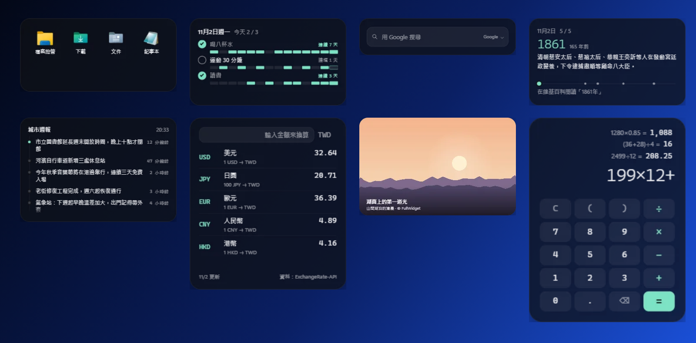
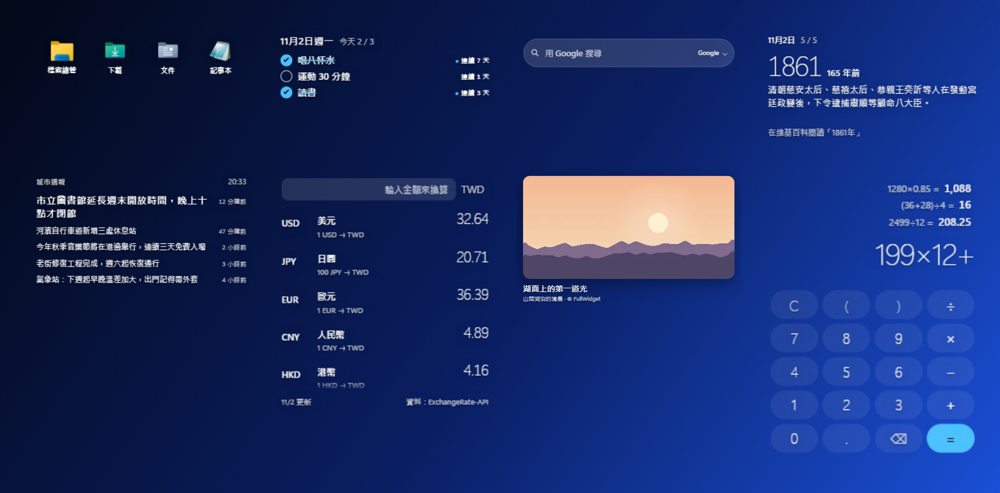
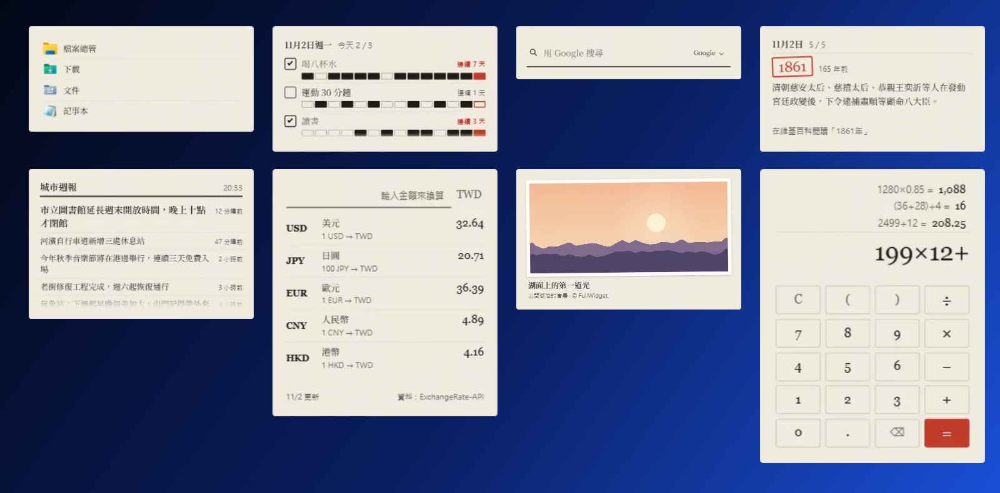

# M8 效率與資訊 — 完成說明

日期：2026-11-02

## 結果

內建組件從 26 個變成 34 個：效率類加了 4 個（快捷啟動、習慣打卡、計算機、搜尋框），資訊類加了 4 個（新聞訂閱、匯率、每日圖片、歷史上的今天）。主程式新增打開程式和檔案、選檔案、讀取圖標、接收拖進組件的檔案，以及 Windows 內建的簡繁轉換。

| 量被畫出來 |
|---|
|  |

| 玻璃上的字 |
|---|
|  |

| 書桌上的紙 |
|---|
|  |

（第一排：快捷啟動、習慣打卡、搜尋框、歷史上的今天；第二排：新聞訂閱、匯率、每日圖片、計算機）

## 8 個新組件

| 組件 | 量被畫出來 | 玻璃上的字 | 書桌上的紙 | 設定項 |
|---|---|---|---|---|
| 快捷啟動 | 圖標格子 | 圖標直接放在桌布上 | 索引卡，一行一個 | 顯示名稱、圖標大小 |
| 習慣打卡 | 每個習慣下一排格子（最近 7 / 14 / 28 天），今天加框 | 清單和連續天數，做完的劃線 | 印好的打卡表，做完塗黑 | 顯示幾天 |
| 計算機 | 石墨按鍵、薄荷色運算符 | 圓形玻璃按鍵 | 加數機紙帶和印刷按鍵 | 千位分隔 |
| 搜尋框 | 圓角輸入框 | 毛玻璃膠囊 | 一條可以寫字的橫線 | 搜尋引擎、自訂搜尋網址 |
| 新聞訂閱 | 時間軸，最新一則亮起 | 頭條放大 | 報紙欄 | 來源、自訂 RSS 網址、多久更新 |
| 匯率 | 代碼、名稱、價格 | 大號細字 | 銀行牌價板 | 我的貨幣、要看的貨幣 |
| 每日圖片 | 圖片鋪滿卡片，說明壓在漸層上 | 圓角照片，說明在桌布上 | 貼在紙上、白邊微斜的照片 | 顯示說明、版本（地區） |
| 歷史上的今天 | 年份和一條時間軸，標出當天每件事的年份 | 大號細體年份 | 曆書，年份蓋朱紅印 | 多久自動換下一則 |

### 各組件的細節

- **快捷啟動**
  - 預設放了檔案總管、下載、文件、記事本，都是電腦上真正的圖標。
  - 加入方式：從檔案總管或瀏覽器把程式、捷徑、資料夾、檔案、網址拖到組件上；或按「編輯」，用「＋ 程式或檔案」「＋ 資料夾」「＋ 網址」加入。
  - 編輯時可以拖動排序、按 × 移除。
  - 名稱和檔案總管顯示的一致，例如捷徑顯示「Excel」、D 槽顯示「Data (D:)」、下載資料夾顯示 Windows 語言的「下載」（這台電腦的 Windows 是簡體中文，所以顯示「下载」）。程式顯示檔案說明裏的名稱。
  - 程式被移走或刪除後，那一格會變淡。
- **習慣打卡**
  - 預設三個例子：喝八杯水、運動 30 分鐘、讀書。
  - 按「編輯」可以增刪，最多 8 個。過了午夜自動換新的一天。
- **計算機**
  - 可以直接用鍵盤輸入算式，例如 `12*(3+4)-5/2`，會即時顯示 `= 81.5`，按 Enter 算出結果。
  - 鍵盤打的 `*` `/` `-` 會顯示成 × ÷ −。
  - 支援百分比和括號，0.1+0.2 會顯示 0.3（沒有浮點誤差）。
  - 算過的式子留在上面，點一下就能拿來接着算。
  - 用的是自己寫的算式解析器，不執行任何程式碼。
- **搜尋框**
  - 預設引擎：繁中 Google、簡中百度、英文 Google。
  - 按右邊的引擎名稱，會在原位出現一排引擎可以切換。
  - 輸入的是網址（例如 example.com）時，直接打開那個網址。
  - 也可以設自訂搜尋網址（`%s` 換成關鍵字）。
- **新聞訂閱**
  - 預設來源：繁中中央社（國際）、簡中 IT之家、英文 BBC World。另有 BBC 中文、香港電台、少數派、The Verge、Hacker News，也可以填任何 RSS / Atom 網址。
  - 點標題用瀏覽器打開，點過的變淡。
  - 離線時顯示上次的內容。
- **匯率**
  - 預設：繁中以新台幣看美元、日圓、歐元、人民幣、港幣；簡中以人民幣看美元、港幣、日圓、歐元、新台幣；英文以美元看歐元、英鎊、日圓、人民幣、加幣。
  - 每一行是「1 美元 = 多少新台幣」；日圓、韓元這類以 100 為單位。
  - 輸入金額後，每一行多出換算結果，例如「1,000 TWD = 30.64 USD」。
  - 從第二天起，和前一天比漲跌：▲ 表示外幣變貴。
  - 按資料來源的使用條款，底下標出「資料：ExchangeRate-API」。
- **每日圖片**
  - Bing 每日一圖，可以翻看最近 8 天；點圖片打開 Bing 上這張圖的介紹。
  - Bing 沒有繁體中文版，所以繁中介面用中國版的說明，再用 Windows 內建的簡繁轉換轉成繁體（例如「北極熊和幼崽，哈得孫灣畔」）。
- **歷史上的今天**
  - 來自維基百科的「歷史上的今天」，中文會按介面語言給繁體或簡體。
  - 每分鐘換一則，也可以按箭頭翻，或點「在維基百科閱讀」。
  - 去掉了原文裏指向首頁圖片的「（圖）」「(pictured)」。

## 主程式和 SDK

| 新功能 | 說明 | 權限 |
|---|---|---|
| `widget.shell.launch(path)` | 打開程式、捷徑、資料夾、文件（像在檔案總管裏雙擊，不能帶參數） | `shell.launch`（新） |
| `widget.shell.info(path)` | 名稱、種類、Windows 顯示的圖標（帶透明度的 PNG） | `shell.launch` |
| `widget.shell.pick({ type, filter })` | 讓用戶選檔案或資料夾 | `shell.launch` |
| `widget.shell.paths(files)` | 拖到組件上的檔案的完整路徑 | `shell.launch` |
| `widget.convertChinese(text, "traditional")` | 簡繁轉換，用 Windows 內建字表 | 不需要 |
| 設定項預設值按語言給 | 以前只有文字類可以，現在下拉選單等都可以（搜尋引擎、貨幣用到） | — |

- 第三方組件要用 `shell.launch`，允許時會看到明顯的警告：「打開你電腦上的程式、資料夾和檔案……只在你信任這個組件時允許。」
- 開發文檔（中英文）已加上這些 API。

## 效能

- 34 種組件全部放上桌面（共 36 個）：處理器約 0.4%（14 個核心合計），記憶體約 355 MB（任務管理器）。M7 時 26 個是 0.3%、291 MB。
- 新組件都只在需要時更新：新聞每 30 分鐘、匯率每 3 小時、每日圖片每 3 小時、習慣打卡只在午夜。

## 實機驗證（Win11、150% 縮放）

- 8 個組件 × 3 套主題都放上桌面看過；預覽圖另外看了簡體中文（書桌上的紙）和英文。
- **快捷啟動**
  - 檔案總管、下載、文件、記事本都顯示真正的圖標。
  - 把一個資料夾和 Excel 的捷徑拖到組件上 → 加入，名稱分別是資料夾名和「Excel」。
  - 點那個資料夾 → 檔案總管打開了它（之後已關掉）。
- **計算機**
  - 用鍵盤打 `12*(3+4)-5/2` → 顯示 `12×(3+4)−5÷2 = 81.5`，按 Enter 得 81.5，記入紀錄。
  - 1280×0.85 = 1,088、0.1+0.2 = 0.3。
- **搜尋框**：點引擎名稱出現一排引擎，選 Bing 後提示變成「用 Bing 搜尋」，設定也跟着存好。
- **匯率**：輸入 1000 → 美元那一行顯示「1,000 TWD = 30.64 USD」。
- **新聞、匯率、每日圖片、歷史上的今天**：都連上真實資料來源顯示。
- **簡繁轉換**：「北极熊和幼崽，哈得孙湾畔，马尼托巴省，加拿大」→「北極熊和幼崽，哈得孫灣畔，馬尼托巴省，加拿大」。
- 編譯 0 錯誤。

## 測試中修掉的問題

| 問題 | 修法 |
|---|---|
| 拖檔案到組件上沒反應 | 組件要求「連結」方式放下，但有些來源只允許「複製」；改成複製（只記路徑，不真的複製檔案） |
| 快捷啟動預設大小一排只放得下 3 個，第 4 個被切掉 | 格子縮小，一排 4 個 |
| 編輯時「完成」按鈕蓋住圖標的 × | 移到下面加入按鈕那一排 |
| 選的資料夾顯示英文名「Downloads」 | 改用檔案總管顯示的名稱（這台電腦是「下载」） |
| 搜尋引擎下拉選單在 90 像素高的組件裏放不下 | 改成在原位出現一排可以選的引擎；玻璃主題下改成不透明，避免後面的字透出來 |
| 匯率每行的大數字是「1 新台幣 = 0.0306 美元」，不直觀 | 改成「1 美元 = 32.64 新台幣」，輸入金額才顯示換算 |
| 匯率預設大小只顯示 3.5 種貨幣 | 預設高度加大 |
| 新聞訂閱的時間軸圓點被裁掉 | 改用內距排版 |
| 習慣打卡在紙主題下像條碼 | 每天改成一個小方框，做完塗黑 |

## 沒驗證 / 要知道的

- **從檔案總管真正用滑鼠拖放**：用開發工具模擬了拖放（和 M4 測 `.fwz` 拖放的方法一樣），沒有用真的滑鼠從檔案總管拖。
- **檔案選擇視窗**（「＋ 程式或檔案」「＋ 資料夾」）用的是 Windows 標準的開啟檔案視窗；按鈕和程式都寫好了，但沒有實際點開選過檔案。
- **網址拖放**：從瀏覽器拖網址進快捷啟動的程式寫好了，沒有實測。
- **中國大陸的網路**：中央社、BBC、Google 在中國大陸可能連不上；簡中預設已改用 IT之家和百度，但沒有在大陸網路下實測。Bing 每日圖片和維基百科在大陸的可用性也沒有驗證（維基百科在大陸通常連不上，組件會顯示「暫時取不到資料」）。
- **匯率漲跌**要到第二天有了前一天的資料才會出現，這次沒看到。
- 每日圖片是 Bing 的版權圖片，只在組件裏顯示，沒有下載或另存。

## 給開發者

- 新檔案：`Shell/Launcher.cs`（打開、圖標、選檔案、簡繁轉換）。
- `Core/Text.cs` 新增 `PickValue`：任何按語言給的值都能取出當前語言的那個。
- `build/previews.json` 新增 `ready`（拍照前等到某個條件成立，例如圖片載入完）。
