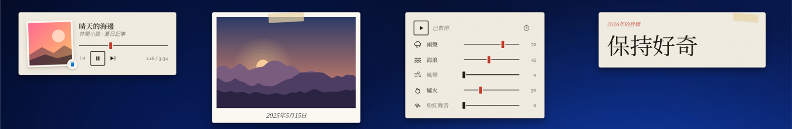

# M9 媒體與收尾 — 完成說明

日期：2026-11-02

## 結果

內建組件從 34 個變成 38 個，達成目標。媒體與裝飾類加了 4 個：媒體控制、相框、白噪音、文字標籤。主程式新增讀取和控制正在播放的媒體，以及「選資料夾」設定項和讀取資料夾裏的圖片。38 個組件在三套主題、三種語言下全部看過一遍，版本升為 1.1.0，發佈檔在 `dist\`。

| 量被畫出來 |
|---|
|  |

| 玻璃上的字 |
|---|
|  |

| 書桌上的紙 |
|---|
|  |

（從左到右：媒體控制、相框、白噪音、文字標籤。媒體控制裏的歌是測試用的無聲播放器，相框裏是畫出來的風景圖，都不是真的照片和歌曲。）

## 4 個新組件

| 組件 | 量被畫出來 | 玻璃上的字 | 書桌上的紙 | 設定項 |
|---|---|---|---|---|
| 媒體控制 | 封面、波形進度條（播到哪裏就亮到哪裏）、薄荷色播放鍵 | 封面像照片放在桌布上，一條細線表示進度 | 封面像貼在卡片上的照片，墨線刻度和紅色滑塊 | 顯示進度、顯示是哪個程式在播放 |
| 相框 | 照片鋪滿卡片，日期和「3 / 6」像相機螢幕一樣壓在照片上 | 圓角照片放在桌布上，日期在下面 | 拍立得：白邊、上面貼一條紙膠帶，日期寫在下面 | 照片資料夾、包括子資料夾、多久換一張、順序、填滿或完整、照片說明 |
| 白噪音 | 調音台，每種聲音一條推桿 | 每種聲音一行大字，越大聲越亮 | 一張印好的表，墨線上一個個滑塊 | 沒有（全在組件上調） |
| 文字標籤 | 名牌，小字前面有一條薄荷色短線 | 字直接寫在桌布上 | 印在卡片上，角落貼一條紙膠帶 | 文字、小字、對齊、字體、粗細、顏色 |

### 各組件的細節

- **媒體控制**
  - 顯示 Windows 媒體控制裏正在播放的內容，和按音量鍵時彈出的面板是同一個來源：Spotify、瀏覽器裏的影片和音樂、媒體播放器等。
  - 按鈕：上一首、播放／暫停、下一首；點進度條可以跳到那裏（要那個程式支援）。
  - 封面角落有一個小圖標，表示是哪個程式在播放；組件夠高時改成一行「圖標＋程式名稱」。
  - 沒有東西在播放時顯示「沒有正在播放的媒體」。
  - 不同大小有不同排法：很矮時只留歌名和按鈕；又窄又高時封面在上、文字和按鈕置中在下面。
- **相框**
  - 預設讀「圖片」資料夾（包括子資料夾），每分鐘換一張，隨機順序，換的時候淡入淡出。
  - 滑鼠移上去，左右兩邊出現箭頭可以翻；也可以按鍵盤左右鍵。
  - 說明預設是拍攝日期（相機記錄的），沒有的話用檔案日期；也可以改成檔名或不顯示。
  - 照片由 Windows 按組件的大小做一張縮小版再顯示，例如 1800 像素寬的照片送到組件時只有 768 像素、14 KB，所以兩千萬像素的照片也不佔多少記憶體；Windows 會自動轉正手機拍的直向照片。
  - 還沒選資料夾或資料夾裏沒有照片時，組件上直接有「選擇資料夾」按鈕。
  - 每半小時重新看一次資料夾，新放進去的照片會加入。
- **白噪音**
  - 五種聲音：雨聲、海浪、風聲、爐火、粉紅噪音，可以一起開、各自調大小。
  - 聲音全部在電腦上即時合成（雜訊加濾波器，海浪和風聲有慢慢起伏的變化），不用下載任何音檔。
  - 把某個聲音推上去就會開始播放；點聲音的圖標或名稱可以直接開關它。
  - 定時停止：按時鐘圖標在 15、30、60、90 分鐘之間切換，時間到會慢慢變小聲再停。
  - 開始和暫停都會淡入淡出。暫停後聲音系統完全停下，不佔處理器。
  - 打開電腦時不會自己開始播放，要按一下才會出聲。
- **文字標籤**
  - 預設一段「保持好奇」，字會自動放到剛好填滿組件的大小，縮放組件時跟着變。
  - 在桌面上連按兩下文字可以直接改；按 Esc 取消，點別的地方或 Ctrl+Enter 存檔。可以分行。
  - 可以在大字上面加一行小字，例如「2026 年的目標」。
  - 字體可選跟隨主題、黑體、明體（簡中叫宋体）、楷體、等寬，用的都是 Windows 自帶的字體。

## 主程式和 SDK

| 新功能 | 說明 | 權限 |
|---|---|---|
| `widget.media` | 正在播放的歌名、歌手、專輯、封面、進度、是哪個程式；播放、暫停、上一首、下一首、跳到某個位置 | `media`（新） |
| 設定項 `folder` | 控制中心裏顯示資料夾路徑和「選擇…」按鈕，選資料夾的視窗會從目前的資料夾開始 | — |
| `widget.files` | 列出用戶選的資料夾裏的圖片、取得縮小版、讀拍攝日期、在組件上直接打開選資料夾的視窗 | 不用聲明：用戶選了資料夾就等於允許 |

- 媒體資訊直接呼叫 Windows 的介面，沒有加入 Windows SDK 套件（會讓小 zip 多 10 MB）。Windows 在換歌、暫停、換程式時會主動通知，不用每秒去問；沒有媒體控制組件在桌面上時，連線會關掉。
- 讀資料夾的規則：只能讀用戶選的那個資料夾（和裏面的子資料夾）裏的圖片；別人寫的組件，`widget.json` 裏寫的預設資料夾不算數，要等用戶自己選過才能讀。
- 第三方組件要用 `media` 時，控制中心會顯示「讀取和控制正在播放的媒體」。
- 開發文檔（中英文）已加上這兩個 API 和 `folder` 設定項。

## 全部 38 個組件檢查一遍

- 把 38 個組件在 3 套主題 × 3 種語言下的組件庫預覽圖排成 9 張總覽圖，逐張看過，沒有缺圖。
- 找到並修好兩個英文介面的問題：
  - **時鐘**（書桌上的紙）：右上角星期印章裏的「Mo」太寬，被框切掉 → 英文時字縮小。
  - **待辦清單**：輸入框的提示「Add an item, press Enter」被切成「…press Ente」→ 改成「Add an item」。
- 這兩個組件的預覽圖已重拍。

## 縮放後的排版

M9 第一次交付時只在預設大小下看過排版。之後補做了縮放測試：每個組件放到 4 種大小，三套主題、繁中和英文都拍下來逐張看，共 798 張：

- **最小**：widget.json 允許的最小寬高。
- **矮而寬**：寬度拉到 1.7 倍，高度最小。
- **高而窄**：高度拉到 1.7 倍，寬度最小。
- **放大**：寬高都拉到 1.9 倍。

放大時沒有問題；問題都出在小、矮、窄的時候，共 22 個組件，全部修好並重測：

| 組件 | 問題 | 修法 |
|---|---|---|
| 媒體控制 | 高而窄時只剩封面，歌名和按鈕不見了；很矮時文字被切掉 | 高而窄改成封面在上、文字和按鈕在下；很矮時改成一行：封面、歌名、按鈕（太窄時只留播放鍵） |
| 自訂資訊卡 | 很矮時上下的行被切掉 | 先把字稍微縮小，還放不下就由最後幾行讓位 |
| 文字標籤 | 很矮時內距佔掉大部分空間，字小得看不清；紙膠帶蓋住字 | 很矮時減少內距、收起小字和紙膠帶 |
| 世界時鐘 | 矮的時候城市名縮到幾乎看不見 | 每個城市只留一行：名稱和時間，字保持可讀 |
| 歷史上的今天 | 最後一行只露出半行 | 按空間算能放幾整行，最後一行加「…」 |
| 系統監控 | 窄的時候右邊的數字被切掉；紙主題矮的時候各行重疊 | 圓環跟着寬度縮小；紙主題矮時只留數字 |
| 匯率 | 矮的時候每行只露出半行 | 矮時收起「輸入金額」那一行，讓給匯率 |
| 時間進度 | 矮的時候格子和文字重疊 | 改成一行一項，格子放在名稱和百分比之間 |
| 一週天氣（紙） | 矮的時候 7 天擠在一起重疊 | 只顯示放得下的天數 |
| 倒數日（紙） | 窄的時候紅色印章蓋住日期 | 太窄時不蓋印章 |
| 日曆 | 窄的時候標題日期被切到一半 | 放不下時以「…」結尾 |
| 磁碟（玻璃） | 矮的時候大數字和文字重疊 | 矮時收起進度線和磁碟名稱 |
| 每日圖片 | 矮的時候說明擠得圖片只剩一條 | 先收起來源，再收起說明，留給圖片 |
| 快捷啟動（紙） | 窄的時候名稱被切成一兩個字 | 太窄時只放圖標 |
| 資源回收筒 | 窄的時候「清空」「打開」一字一行 | 按鈕不換行；窄而高時圖示在上、文字在下 |
| 電源 | 窄的時候按鈕下的名稱被切掉 | 太窄時只放圖標（滑鼠移上去有提示） |
| 日出日落（紙） | 矮的時候最下面一行切掉一半 | 先縮成一行，再矮就收起 |
| 使用曲線 | 窄的時候右上角的時間範圍被切掉 | 太窄時收起 |
| 電池 | 英文窄的時候「Fully charged」被切掉 | 允許換行 |
| 搜尋框 | 窄的時候搜尋提示只剩兩個字 | 太窄時引擎只留下拉箭頭，讓出空間 |
| 電腦資訊 | 矮的時候最後一行被切掉一半 | 只顯示放得下的整行 |
| 習慣打卡 | 很矮時只露出半個習慣 | 很矮時收起日期那一行；列表底部淡出，表示可以捲動 |

- **找到的共同原因**：一部分「小尺寸時收起某樣東西」的規則被主題自己的規則蓋過，或者寫在組件的外框上（這種寫法對外框本身無效），所以從來沒生效。已全部改正，其他組件也檢查過，沒有同樣的問題。
- **用真的滑鼠拖右下角**（不是用命令改大小）：
  - 把媒體控制從 340×136 拖成 200×276 → 版面即時變成封面在上。
  - 再拖成 420×64 → 變成一行。
  - 尺寸都存進了設定。

## 拉大時內容跟着變大

以前把組件拉大，字和圖標維持原來的大小，只是多出很多空白。現在拉得比預設大時，整張卡片的內容按比例放大：

- 放大倍數取「寬放大幾倍」和「高放大幾倍」中較小的那個，最多 3 倍。例如拉到兩倍寬、1.3 倍高，內容放大 1.3 倍，多出來的寬度交給排版。
- 比預設小時不縮小，沿用上面修好的小尺寸排版。
- 卡片的圓角、邊框和陰影不跟着變粗。
- **清單類的組件放大得少一點**：便利貼、待辦清單、新聞訂閱是一半，習慣打卡、匯率、快捷啟動是七成。這樣拉大時字變大一點，同時多顯示幾項。其他組件完全跟着放大。
- **實測**：
  - 38 個組件在 1.4 倍、1.9 倍，以及「兩倍寬、1.3 倍高」三種大小下，三套主題都拍下來看過。
  - 找到並修好兩個問題：翻頁時鐘放大後數字比翻牌還大，被切掉；一週天氣（紙）在中等高度時只顯示 4 天。
  - 用真的滑鼠把番茄鐘從 300×170 拖到 580×337，內容即時放大 1.94 倍。
- **給開發者**：`widget.json` 的 `size` 加上 `"grow": 1`（0 到 1）就有這個效果，不寫就和以前一樣。開發文檔中英文都寫了；新建組件的範本預設是 1。

## 效能

- 38 種組件全部放上桌面（媒體控制正在播放、相框每 10 秒換一張）：處理器約 0.4%（14 個核心合計，約一個核心的 6%），記憶體約 355 MB（任務管理器）。和 M8 放 34 種時一樣。
- 白噪音五種聲音全開時，整個 FullWidget 約佔 0.4% 處理器；暫停後回到 0.04%。

## 實機驗證（Win11、150% 縮放）

- **媒體控制**：用一個無聲的測試播放器（三首測試歌，帶標題和封面）在 Windows 媒體控制裏播放。
  - 組件馬上顯示歌名「晴天的海邊」、歌手、專輯、封面和 3:34 的長度，時間每秒往前走。
  - 按「下一首」→ 換成「夜航」，「上一首」變成可以按；按暫停 → 時間停住，再按繼續播放。
  - 程式名稱和圖標：測試播放器顯示為「mediatest」和它的圖標。
- **相框**：用 6 張畫出來的風景圖測試，包括子資料夾裏的。
  - 拍攝日期、「1 / 6」、下一張的淡入淡出都正常；三套主題都看過。
  - 在控制中心按「選擇…」→ 出現標題為「照片資料夾」的 Windows 選資料夾視窗；按取消後設定沒變。
- **白噪音**：把聲音送到一個不出聲的輸出（測試時你的喇叭不會響），測量音量：
  - 五種聲音都有輸出，各自的音量差不多；五種全開時最大值 0.70（滿格是 1），不會爆音。
  - 暫停後聲音系統停下，所有聲音拆掉。
- **文字標籤**：連按兩下、輸入「今天也要好好的」、點別的地方 → 存進設定，字自動縮到放得下；再改一次按 Esc → 沒有存。
- **發佈檔**：用新的資料夾啟動 `dist` 裏的 1.1.0，找到 38 個組件，加入 4 個新組件，正常退出；沒有在登錄檔留下開機啟動或檔案類型。
- 編譯 0 錯誤；45 個 JavaScript 檔案語法檢查通過。

## 測試中修掉的問題

| 問題 | 修法 |
|---|---|
| 媒體控制在「量被畫出來」和「書桌上的紙」裏看不到進度和時間 | 「小尺寸只留按鈕」的條件設得太早觸發；改條件，預設高度加一點 |
| 白噪音只開一種聲音時偏小聲 | 整體調大，加上限幅器，五種全開也不會爆音；海浪調小一點，風聲和粉紅噪音調大一點 |
| 文字標籤（書桌上的紙）的紙膠帶蓋住小字 | 紙膠帶移到另一個角 |
| 選資料夾的視窗總是從「文件」開始 | 改成從目前選的資料夾開始 |

## 發佈

- `dist\FullWidget-1.1.0-win-x64.zip`：4.0 MB，需要 .NET 9 桌面執行階段（1.0.0 是 0.9 MB；多出來的是 38 個組件和它們的 342 張預覽圖）。
- `dist\FullWidget-1.1.0-win-x64-full.zip`：48 MB，不用另外安裝。
- 1.0.0 的兩個 zip 留在 `dist\` 裏沒有刪。
- README（中英文）已改成 38 個組件。

## 沒驗證 / 要知道的

- **白噪音的聲音好不好聽**：我量得到音量、確認沒有爆音和斷音，但聽不到聲音本身；雨聲、海浪這些像不像，要你戴上耳機聽一下。
- **真正的音樂程式**：媒體控制是用測試播放器驗證的，沒有用 Spotify、瀏覽器或媒體播放器實測。有些瀏覽器不提供歌曲長度，那時組件不顯示進度條。
- **程式名稱**：測試播放器顯示「mediatest」。Spotify、Edge、Chrome、Firefox、媒體播放器等會用開始選單裏的名稱和圖標，但沒有逐一實測。
- **同時有兩個程式在播放**：組件跟隨 Windows 認為的「目前」那一個（通常是最後操作的），不能自己選。
- **相框的 HEIC 照片**（iPhone 拍的）：要裝了 Windows 的 HEIF 擴充功能才能顯示，沒有的話會跳過那張。這台電腦沒有測。
- **相框沒有實際用滑鼠在選資料夾視窗裏選過資料夾**：按鈕能打開視窗、取消正常，選了之後的流程用命令測過。
- 預覽圖裏媒體控制的歌名、相框的風景圖都是做出來的示意內容；相框用的 6 張圖放在 `build\preview-photos`，只用來產生預覽圖，不會打包進發佈檔。

## 給開發者

- 新檔案：
  - `Providers/MediaSession.cs`：Windows 媒體控制，按方法編號直接呼叫 WinRT 介面；事件處理用的介面編號是按 WinRT 的規則從型別名稱算出來的。
  - `Providers/FolderFiles.cs`：列出資料夾裏的圖片、用 Windows 的縮圖做縮小版、讀拍攝日期。
- 組件頁面上的新網址：`/__media/cover/<編號>`（封面）、`/__files/<設定名>/<路徑>?w=<寬>`（資料夾裏的圖片）。
- `build/make-previews.mjs`：範例設定裏的 `{root}` 會換成專案資料夾。
